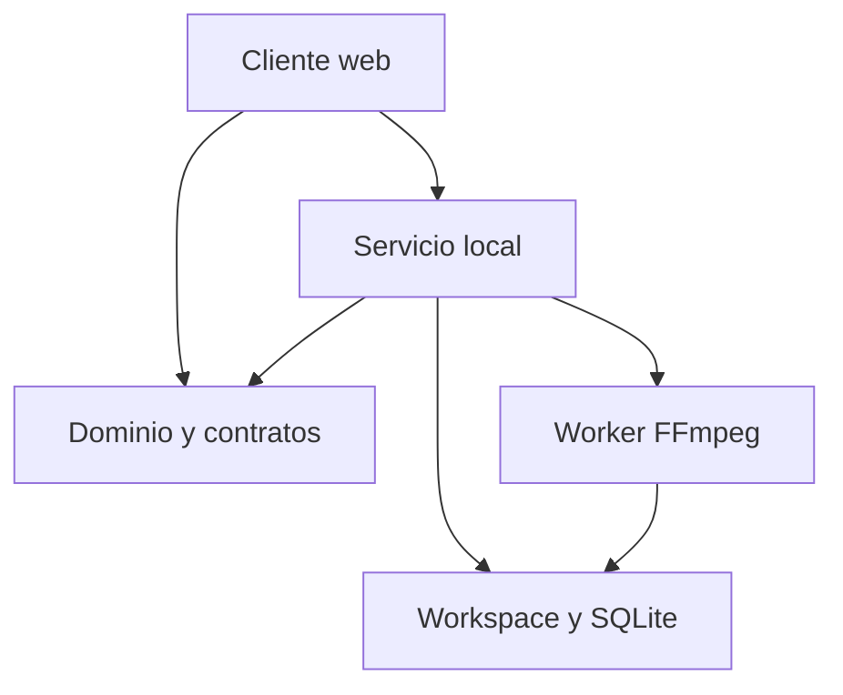

# Arquitectura de arranque

Cliente web y servicio local son componentes distintos. El cliente presenta
timeline, visor e inspector; un paquete de dominio define tiempo, invariantes y
comandos; el servicio valida, persiste y administra jobs; un worker aislado
ejecuta FFmpeg/ffprobe. El manifiesto de proyecto es la autoridad del montaje.
SQLite mantiene índice y estado de trabajos, sin ser otra timeline editable.

## Invariantes que resolver al principio

- Proyecto a 30/1 fps, frames enteros, intervalos semiabiertos. Fuente conserva
  PTS + time base racional; audio se mezcla a 48 kHz. No redondear en cada
  comando ni acumular float.
- Todo comando valida el conjunto antes de mutarlo y ofrece inversa. Preview y
  render interpretan el mismo montaje y orden de operaciones.
- Guardado con expectedRevision, temporal, publicación atómica y revisión
  durable confirmada. Mantener copia previa y snapshots.
- Un job fija revisión y ajustes. Una edición posterior no cambia lo ya
  exportándose. Cancelar antes del commit no puede publicar parcial; después del
  commit devuelve ALREADY_TERMINAL.
- Tras reinicio, reconciliar jobs contra workers/salidas verificadas; no
  reanudar silenciosamente ni crear duplicados por timeout de UI.
- El servicio usa rutas relativas confinadas al workspace; los argumentos de
  FFmpeg se construyen como lista, sin shell. Importación y salida por
  streaming; presupuestos de CPU/memoria/tiempo configurables.

## Preview

Comparar compositor cliente con proxies CFR y preview final servido por el motor
de render. Elegir con evidencia de seek, A/V y fidelidad. Varios elementos video
independientes no constituyen una prueba de sincronización. Si el preview
interactivo reduce calidad o aún procesa, debe indicarlo; la exportación usa
fuentes originales o intermedios de calidad.

## Modelo y nombres

schemaVersion y revision son propiedades ASCII de contratos; la palabra
«revisión» de la tabla narrativa v1 no exige claves acentuadas. El esquema de
specification/project.schema.json propone una estructura concreta para arrancar;
estabilizarla en H1 y versionar cambios. La API debe validar también las
invariantes cruzadas que JSON Schema no puede expresar por sí solo.

Conservar: Project, Asset, Track, Clip, LinkGroup, ExportJob, Snapshot y
Derivative. Un clip referencia un stream y un asset; separar audio es separar
instancias vinculadas, no duplicar el archivo ni reproducir ambos sonidos a la
vez.

## Contratos HTTP

Usar los contratos de la especificación v1 y documentarlos con una
especificación de API al implementarlos. Prefijo recomendado /api. Errores:
code, message, recoveryAction, requestId. Rutas de ejemplo: projects,
assets/import, manifest con expectedRevision, exports con idempotencyKey,
jobs/:id, jobs/:id/cancel, jobs/:id/output y diagnostics. Elegir y fijar una
convención única en H0/H1.

No hay OpenAI API, modelo remoto o SDK de agentes como dependencia de Jencut M1.
Codex es la herramienta de desarrollo, no una función interna del editor.
