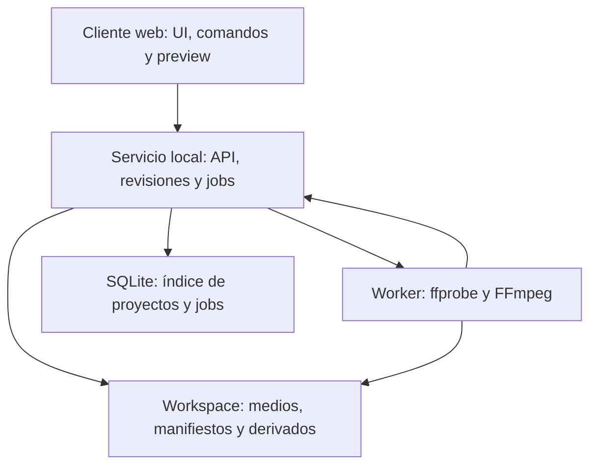
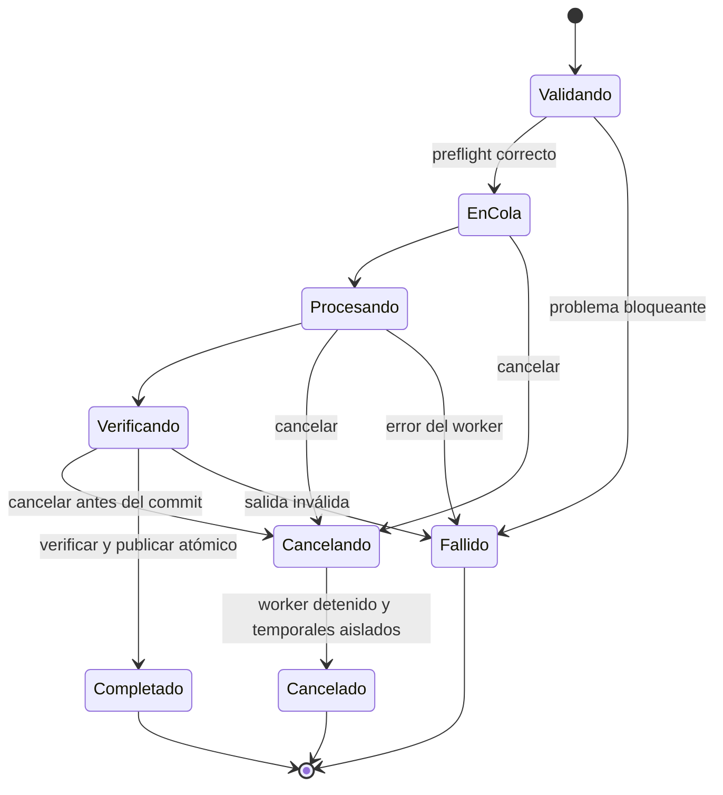
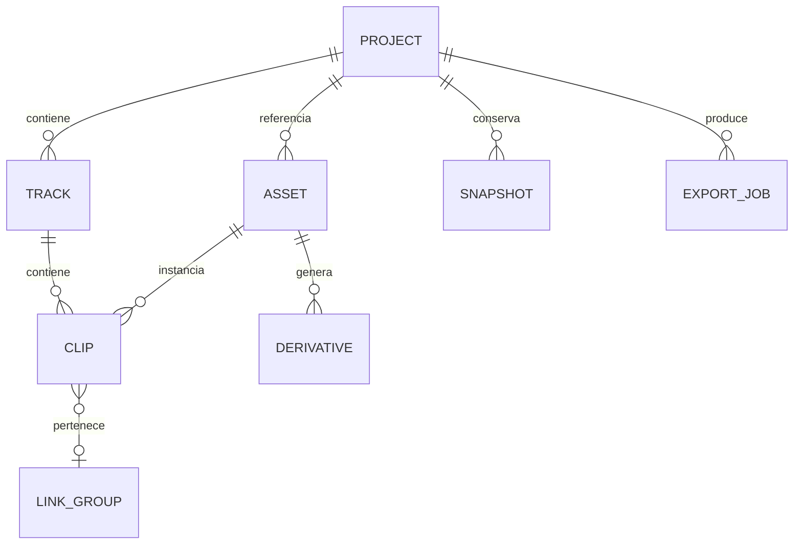

# Jencut - paquete de preproducción v1.0

Fecha de línea base: 28 de octubre de 2026. Propietario del producto: Jeancarlo. Estado: especificación propuesta y prototipo de navegacion; no hay editor implementado ni benchmarks ejecutados.

Este paquete convierte la idea de editor personal en un alcance verificable. Nombre, ruta visual A / Precision y Manrope + Inter fueron elegidos por el usuario. Jeni se conserva como propuesta de mascota presentada en esta conversacion, pendiente de ratificar como arte final. Las decisiones funcionales y técnicas nuevas son recomendaciones de esta línea base, no preferencias previamente confirmadas.

## Como revisarlo

1. Leer visión y límites en 01. Revisar especialmente el procesamiento local, formatos y envolvente de trabajo.
2. Recorrer los flujos y reglas de 02. Acordar que significan dividir, recortar, desvincular, extraer y cerrar hueco.
3. Revisar requisitos de 03 y sus criterios. La primera entrega M1 ya incluye los efectos básicos solicitados.
4. Abrir Jencut-wireframes-prototipo.pdf y navegar con los botones. Es un prototipo de estados enlazados: no procesa medios ni demuestra rendimiento.
5. Consultar calidad/pruebas, arquitectura y trazabilidad. Ejecutar los spikes al comenzar implementación, antes de comprometer soporte avanzado.

## Archivos

- 01: visión, alcance, supuestos, objetivos y resultados esperados.
- 02: nueve flujos completos, reglas y maquinas de estados.
- 03: requisitos funcionales con dependencias y aceptacion.
- 04: atributos medibles, corpus, casos de prueba y plan de aceptacion.
- 05: arquitectura propuesta, modelo de datos y contratos.
- 06: sistema de interacción, pantallas, atajos y guion de prototipo.
- 07: matriz completa de trazabilidad, con pruebas aún no ejecutadas.
- 08: backlog por entregas, riesgos, decisiones y preguntas pendientes.
- 09: puertas de entrada a desarrollo, orden de trabajo y definición de terminado.
- 10: fuentes técnicas consultadas y distincion entre evidencia y recomendacion.
- 11: diagramas editables de componentes, estados y modelo de dominio.
- especificacion.json: datos estructurados editables que respaldan tablas y requisitos.
- Dos PDF: especificación consolidada y wireframes/prototipo con enlaces internos.
- assets/fonts: tipografías y licencias obtenidas de Google Fonts, más instancias para los PDF.

## Lo que ya se puede hacer con este paquete

Crear issues, estimar tareas, revisar UX, escribir pruebas y comenzar los experimentos de compatibilidad. No se certifica aún soporte de codecs, velocidad de render, igualdad de color o fiabilidad del software, porque todavia no existe una implementacion.

No se ha escrito ni publicado codigo de la aplicacion. Los scripts usados para preparar estos documentos son herramientas de preparación documental y no forman parte del producto.

---

# Visión y alcance

## Visión

Jencut será un editor de video personal con interfaz web, orientado a escritorio, que permita a Jeancarlo transformar fragmentos de video, audio e imagen en piezas terminadas mediante montaje no destructivo, control temporal preciso y exportación verificable. Su identidad Precision combina claridad, control y el uso moderado de lavanda.

## Problema y propuesta de valor

La necesidad expresada es reunir en una herramienta propia la importación de varios clips, corte, division, separacion de audio y efectos. No se atribuyen dolores o habitos adicionales al usuario sin validarlos. La propuesta es una herramienta a medida, con un flujo consistente de importar -> montar -> ajustar -> exportar y recuperación visible del trabajo.

El objetivo no es replicar todas las funciones de una suite comercial de una sola vez. Se prioriza un nucleo utilizable y extensible, con contratos temporales y de medios capaces de sostener las ampliaciones.

## Persona y contexto de uso

Usuario principal: Jeancarlo, desarrollador y propietario del producto. Uso inicialmente individual, con teclado, mouse y pantalla de escritorio. Ejemplos de tareas por validar: montajes personales, demostraciones de software, piezas verticales y contenido para proyectos. Estos ejemplos no se convierten automaticamente en funciones comerciales, colaboracion o IA.

Hipotesis de operación: Windows 11 y Chromium de escritorio; la interfaz se abre en el navegador y un servicio local administra archivos y procesa medios. Es una aplicación web local, no una aplicación nativa de escritorio. Si el servicio se aloja después en otro equipo, los medios vivirian en ese host y requeririan una nueva decisión de privacidad y acceso.

## Alcance M1 - primera versión utilizable

Crear/reabrir/duplicar proyectos; importar MP4 H.264/AAC, audio e imagen certificados; biblioteca; hasta 4 pistas visuales y 4 de audio; preview y avance por frame; seleccionar, mover, trim, split, duplicar y borrar; cierre de hueco conservador; audio vinculado/desvinculado, extracción WAV, ganancia y fundidos; transformar, brillo/contraste/saturacion, opacidad/fades; títulos e imagenes; undo/redo; autosave, snapshots y relocalización; exportación 720p/1080p30; cola, cancelación y reintento; manifiesto portable sin medios; cache y diagnóstico; alternativas accesibles al arrastre.

M1 conserva una base temporal fija de 30/1 fps CFR y SDR. Se ofrecen formatos 1920x1080, 1080x1920 o 1080x1080, con variantes 720 equivalentes. El proyecto no cambia de fps después de editar; formatos avanzados requieren una nueva secuencia en M2.

## Envolvente objetivo por validar

- H1: equipo de referencia propuesto de 6 núcleos físicos o rendimiento equivalente, 16 GiB RAM, SSD y 40 GiB libres; registrar modelo real antes de medir. No es un dato confirmado del equipo del usuario.
- E1: salida de hasta 10 minutos, hasta 50 clips de montaje y 30 assets fuente, hasta 10 GiB de originales administrados por proyecto. Límite individual inicial de archivo: 2 GiB, configurable solo tras pruebas de streaming y disco.
- Preview de referencia C1: 2V+2A a 720p30. La interfaz admite hasta 4V+4A, pero esa carga puede requerir degradacion explicita del preview; no se promete tiempo real en todos los casos.
- El servicio mantiene importación y exportación por streaming, sin cargar videos completos en memoria. Preflight informa que falta espacio incluso dentro de E1.
- Estos límites son presupuesto de ingenieria y objetivos de prueba. No son capacidades ya demostradas ni límites universales del navegador.

## M2 y M3

M2: marcadores/rangos, velocidad, disoluciones entre clips, keyframes, subtitulos manuales/SRT, 4K y fps adicionales certificados, paquete portable con medios. M3: transcripción local opcional y efectos avanzados descompuestos en futuras historias verificables.

## Fuera del alcance inicial

Colaboracion multiusuario, cuentas SaaS, facturacion, marketplace, publicación directa a redes, aplicaciones moviles de edición, HDR profesional, multicamara, RAW de camara, plugins arbitrarios y render distribuido. Una segunda pestana del mismo proyecto se abre en solo lectura para evitar conflictos.

## Resultados y medidas de exito

El usuario completa un montaje de cinco clips con corte, audio separado, título, ajuste visual y exportación; puede cerrar/reabrir sin perder la última revisión confirmada; el original conserva su hash; el archivo exportado tiene streams y duración correctos. Latencia, memoria y exportación se miden con los criterios de calidad de 04, aún pendientes de ejecutar.

## Objetivos trazables

| ID | Objetivo |
| --- | --- |
| OBJ-01 | Convertir fragmentos de video en un montaje completo sin modificar los archivos originales. |
| OBJ-02 | Controlar audio, composición, títulos y efectos básicos en una misma interfaz. |
| OBJ-03 | Conservar y recuperar el trabajo de forma verificable. |
| OBJ-04 | Exportar un archivo reproducible y coherente con la línea de tiempo. |
| OBJ-05 | Trabajar con privacidad, respuesta predecible y operaciones accesibles. |

## Supuestos y decisiones pendientes

Procesamiento local, hardware H1, formatos y límites E1 son supuestos propuestos. Falta validar videos reales del usuario, tolerancia a instalar un servicio local, necesidad de HEVC de telefono y prioridad de 4K/subtitulos. Mientras no se cambien, esta especificación mantiene una línea base coherente y evita bloquear las tareas de diseno.

---

# Flujos y reglas de dominio

Cada flujo describe estado inicial, ruta principal, excepciones y resultado. Todos corresponden al actor Usuario; Servicio de medios y Sistema de archivos son participantes tecnicos.

## FL-01 - Inicio y proyecto

Pantallas: UI-01 -> UI-02 -> UI-04. Requisitos: RF-01 RF-02 RF-50 RF-54.

Precondicion: servicio disponible y proyecto abierto, salvo FL-01; FL-08 permite partir de un manifiesto importado.

Ruta principal: Elegir Nuevo proyecto; nombrar, seleccionar formato y confirmar; mostrar editor vacio y guardado inicial.

Alternativas: Proyecto existente: abrirlo. Servicio ausente: mostrar diagnóstico y reintento. Segunda sesión: abrir solo lectura.

Postcondicion: proyecto consistente o estado anterior intacto; errores se muestran con accion de recuperación y nunca se ocultan como exito.

## FL-02 - Importar y preparar

Pantallas: UI-04 -> UI-03 -> UI-04. Requisitos: RF-03 RF-04 RF-05 RF-06 RF-52.

Precondicion: servicio disponible y proyecto abierto, salvo FL-01; FL-08 permite partir de un manifiesto importado.

Ruta principal: Seleccionar o arrastrar lote; copiar a almacenamiento administrado, inspeccionar, mostrar errores individuales y crear derivados.

Alternativas: Duplicado: reutilizar asset por hash y dejar trazabilidad; codec no certificado: marcar incompatible o solicitar conversion cuando este disponible; cancelar conserva resto.

Postcondicion: proyecto consistente o estado anterior intacto; errores se muestran con accion de recuperación y nunca se ocultan como exito.

## FL-03 - Montar y editar

Pantallas: UI-04 -> UI-05 -> UI-04. Requisitos: RF-07 RF-08 RF-09 RF-10 RF-11 RF-12 RF-13 RF-14 RF-15 RF-25 RF-39 RF-40.

Precondicion: servicio disponible y proyecto abierto, salvo FL-01; FL-08 permite partir de un manifiesto importado.

Ruta principal: Agregar a pista libre; seleccionar; posicionar cabezal; dividir o recortar; mover; comprobar resultado; deshacer si procede.

Alternativas: Colision: rechazar y resaltar destino. Vinculo/bloqueo: actuar atomico. Ripple: elegir intervalo y pistas; preflight y vista previa del efecto temporal.

Postcondicion: proyecto consistente o estado anterior intacto; errores se muestran con accion de recuperación y nunca se ocultan como exito.

## FL-04 - Trabajar audio

Pantallas: UI-05 -> UI-06 -> UI-04. Requisitos: RF-16 RF-17 RF-18 RF-19.

Precondicion: servicio disponible y proyecto abierto, salvo FL-01; FL-08 permite partir de un manifiesto importado.

Ruta principal: Seleccionar par V/A; desvincular cuando se necesite; mover audio, ajustar ganancia y fundidos; escuchar mezcla; opcionalmente extraer WAV.

Alternativas: Sin stream de audio: deshabilitar extraccion. Evitar audio duplicado; avisar de clipping y mantener política de limitacion final visible.

Postcondicion: proyecto consistente o estado anterior intacto; errores se muestran con accion de recuperación y nunca se ocultan como exito.

## FL-05 - Componer y aplicar efectos

Pantallas: UI-05 -> UI-07 -> UI-04. Requisitos: RF-20 RF-21 RF-22 RF-23 RF-24.

Precondicion: servicio disponible y proyecto abierto, salvo FL-01; FL-08 permite partir de un manifiesto importado.

Ruta principal: Seleccionar clip; transformar; ajustar brillo/contraste/saturacion; configurar fade; agregar título o imagen en pista superior.

Alternativas: Datos inválidos: no aplicar. Texto fuera de lienzo: aviso. Desactivar efecto compara antes/despues sin perder parametros.

Postcondicion: proyecto consistente o estado anterior intacto; errores se muestran con accion de recuperación y nunca se ocultan como exito.

## FL-06 - Guardar y recuperar

Pantallas: UI-04 -> UI-10 -> UI-04. Requisitos: RF-26 RF-27 RF-32 RF-48 RF-54.

Precondicion: servicio disponible y proyecto abierto, salvo FL-01; FL-08 permite partir de un manifiesto importado.

Ruta principal: Confirmar cambios; guardar revisión; mantener snapshot; al reabrir comparar última revisión válida y ofrecer recuperación cuando sea necesario.

Alternativas: Disco lleno: indicar Sin guardar y exportar manifiesto. Copia corrupta: retroceder a revisión válida; manifiesto sin medios: relocalizar.

Postcondicion: proyecto consistente o estado anterior intacto; errores se muestran con accion de recuperación y nunca se ocultan como exito.

## FL-07 - Exportar resultado

Pantallas: UI-04 -> UI-08 -> UI-09 -> UI-12. Requisitos: RF-28 RF-29 RF-30 RF-49.

Precondicion: servicio disponible y proyecto abierto, salvo FL-01; FL-08 permite partir de un manifiesto importado.

Ruta principal: Fijar revisión; elegir preset/ruta; ejecutar preflight; encolar render; seguir progreso; inspeccionar y publicar; abrir o descargar.

Alternativas: Cancelar, fallar o desconectar tienen estados distintos. Reintento es job nuevo; si se edito durante render indicar revisión exportada.

Postcondicion: proyecto consistente o estado anterior intacto; errores se muestran con accion de recuperación y nunca se ocultan como exito.

## FL-08 - Resolver medios

Pantallas: UI-10 -> UI-03 -> UI-04. Requisitos: RF-31 RF-33.

Precondicion: servicio disponible y proyecto abierto, salvo FL-01; FL-08 permite partir de un manifiesto importado.

Ruta principal: Detectar referencias ausentes; elegir archivos; comparar identidad; aceptar sustitucion si procede; revalidar todas las instancias.

Alternativas: No aceptar homonimos automaticamente; si fuente más corta, listar clips fuera de rango y bloquear exportación hasta resolver.

Postcondicion: proyecto consistente o estado anterior intacto; errores se muestran con accion de recuperación y nunca se ocultan como exito.

## FL-09 - Preferencias y soporte

Pantallas: UI-04 -> UI-11 -> UI-04. Requisitos: RF-34 RF-35 RF-36 RF-37 RF-38 RF-51.

Precondicion: servicio disponible y proyecto abierto, salvo FL-01; FL-08 permite partir de un manifiesto importado.

Ruta principal: Consultar almacenamiento y diagnóstico; limpiar cache regenerable; ajustar tema, escala, atajos y visibilidad de Jeni.

Alternativas: Limpieza respeta tareas activas; una preferencia de UI no altera video final; no perder montaje al cerrar preferencias.

Postcondicion: proyecto consistente o estado anterior intacto; errores se muestran con accion de recuperación y nunca se ocultan como exito.

## Reglas de negocio y edición

| ID | Regla | Definición |
| --- | --- | --- |
| RN-01 | Identidad de proyecto | Un proyecto usa UUID y versión de esquema. El nombre es una etiqueta, no una ruta ni una clave unica. |
| RN-02 | Tiempo preciso | El proyecto M1 usa frames enteros a 30/1 fps y rangos semiabiertos [inicio, fin). Las fuentes conservan PTS racional. Audio se evalua a 48 000 muestras/s. No acumular tiempos mediante sumas float. |
| RN-03 | Medios M1 | Entrada certificada objetivo: MP4/H.264 8 bit SDR y AAC; WAV PCM, MP3, PNG y JPEG. MOV, WebM, HEVC, HDR y codecs adicionales quedan detectados pero requieren una extension de la matriz certificada. |
| RN-04 | No destructivo | Un asset conserva contenido inmutable y huella SHA-256 calculada en streaming; varias instancias referencian la misma fuente. Un cambio de montaje nunca reescribe el original. |
| RN-05 | Compatibilidad explicita | Detectar codec, no inferirlo de la extension. M1 se evalua en Windows 11 + Chromium de escritorio con servicio local; otros entornos son experimentales hasta probarse. |
| RN-06 | Tipos de pista | Una pista visual admite video, imagen o título; audio va en pistas de audio. Importar video con sonido crea instancias V/A vinculadas en pistas libres. Sin sitio para ambas se solicita ubicación, sin perder sonido. |
| RN-07 | Colisiones | En M1 los clips de una misma pista no se solapan. Un movimiento o trim que colisiona se rechaza. Clips de diferentes pistas si pueden coincidir y se componen/mezclan. |
| RN-08 | Composición | V1 es fondo y V4 la superior. Componer de abajo arriba con alfa; zonas sin video son negras y sin audio son silencio. Pistas ocultas/silenciadas no contribuyen al render. |
| RN-09 | Edición por límites | Duración mínima: un frame del proyecto. Split solo en inicio < cabezal < fin. Trim conserva la posición de vecinos. Entradas numéricas y arrastre comparten el mismo comando validado. |
| RN-10 | Preview frente a maestro | Los proxies son derivados. El resultado final usa originales o intermedios de calidad. Un seek se considera realizado al presentar el frame solicitado, con indicador si esta pendiente. |
| RN-11 | Vinculo de audio | Un par vinculado conserva asset, rangos fuente y offset temporal. Split/move/trim actuan sobre el grupo salvo desvinculación explicita. Desvincular no genera copia ni mezcla duplicada. |
| RN-12 | Cierre de hueco | Ripple actua sobre un intervalo y conjunto explicito de pistas; desplaza clips completamente posteriores. Si cruza clips, pistas bloqueadas o vinculos externos incompatibles, la operación se rechaza y se explica. |
| RN-13 | Cadena de audio | Decodificar -> remuestrear 48 kHz -> rango -> ganancia -> fundidos -> mezcla -> limitador final a -1 dBTP -> AAC o WAV. El control de monitor solo cambia escucha. Registrar que el limitador puede alterar picos. |
| RN-14 | Cadena visual | Orientacion fuente -> rango temporal -> escala/crop -> corrección básica -> transformación en lienzo -> opacidad/fades -> composición por pistas -> títulos según su orden -> codificación SDR Rec.709. Definir políticas de rango y gamma en el spike. |
| RN-15 | Comandos atómicos | Un gesto confirmado equivale a un comando validado y reversible. Si falla una condicion se rechaza todo el comando. Guardado durable y estado de historial son conceptos separados. |
| RN-16 | Versionado y durabilidad | Guardar con revisión esperada, escribir temporal y publicar mediante reemplazo atomico. Conservar revisión previa válida y snapshots. Un manifiesto exportado no incluye medios. |
| RN-17 | Exportación consistente | Cada job fija revisión inmutable y ajustes. Validar recursos antes de iniciar; el progreso refleja tiempo procesado, no garantiza ETA. Finalizar exige inspección y publicación atómica; no sobrescribir sin accion explicita. |
| RN-18 | Jobs y concurrencia | Un render activo por equipo en M1; proxies con concurrencia máxima 2 configurable. Solicitudes usan idempotency key. Cancelacion/fallo son terminales; reintento crea job nuevo. Edición puede continuar sobre revisión posterior. |
| RN-19 | Almacenamiento administrado | El servicio administra medios importados, cache, proxies y renders en directorios separados. Cache usa claves versionadas, cuota configurable y leases. Se monitoriza espacio antes y durante tareas. |
| RN-20 | Interacción accesible | Toda accion de arrastre tiene alternativa por teclado y por click sin arrastre. No depender solo de color. Jeni es decorativa, ocultable y respeta movimiento reducido. |
| RN-21 | Funciones opcionales | Ningun servicio externo recibe medios sin una decisión posterior explicita. Funciones M3 requieren requisitos detallados antes de entrar en desarrollo. |
| RN-22 | Límites del servicio local | Bind loopback por defecto, origen/Host permitidos y token de sesion. Construir argumentos de procesos sin shell; resolver rutas dentro de raices autorizadas y controlar recursos de cada tarea. |

## Ejemplos temporales de referencia

- A 30 fps, un clip en [0, 300) dura 10 s. Split en frame 120 produce [0,120) y [120,300), sin duplicar ni omitir el frame de frontera.
- Un clip fuente de 20 s colocado en timeline frame 300, con IN fuente 5 s y duración 120 frames, muestra el intervalo fuente [5 s,9 s) durante [300,420). La conversion usa PTS racional y la política de muestreo de la fuente.
- Eliminar [90,150) deja un hueco de 60 frames. Cerrar ese hueco en pistas participantes desplaza los clips posteriores 60 frames a la izquierda, solo si nadie cruza el intervalo y todos los vinculos quedan consistentes.
- Desvincular V/A no crea otro sonido: cambia la relación entre las dos instancias existentes. Extraer audio crea un archivo WAV y no cambia la mezcla por si mismo.

## Estados de proyecto

Nuevo -> limpio -> modificado -> guardando -> limpio. Un error de guardado vuelve a modificado con aviso persistente. Un conflicto lleva a recuperación; la revisión durable anterior permanece. Recuperación -> limpio cuando se carga o duplica una revisión valida. Solo lectura nunca admite comandos de escritura.

## Estados de asset

Registrado -> copiando -> inspeccionando -> listo. Los derivados pueden seguir en preparando sin bloquear información ya validada. Incompatible/fallido/cancelado son resultados visibles; una referencia perdida pasa a ausente y vuelve a inspeccionando tras relocalizar.

## Estados de render

Validando -> en cola -> procesando -> verificando -> completado. Desde en cola/procesando/verificando antes del commit: cancelando -> cancelado. Después de la publicación, cancelar responde ALREADY_TERMINAL y conserva el resultado completado. Al reiniciar, un job sin worker ni salida verificada se marca fallido recuperable por interrupcion; no se reanuda silenciosamente. Cualquier fallo verificable termina en fallido. No hay transicion de cancelado a completado. Un reintento crea un job nuevo; una respuesta de red desconocida obliga a consultar el job existente mediante idempotency key antes de crear otro.

---

# Requisitos funcionales y aceptacion

Todos estan especificados, no implementados. Must=M1, Should=M2 y Could=M3. Las dependencias se refieren a capacidad de producto, no implican que cada requisito deba producir un módulo separado. RF-53 es una épica exploratoria y requiere desglose posterior.

## RF-01 - Crear proyecto

Entrega: M1 / Must. Objetivo: OBJ-01. Flujo: FL-01. Pantalla de referencia: UI-02.

Como usuario quiero crear proyecto para avanzar en el objetivo descrito, conservando un proyecto consistente.

Criterio de aceptacion: Crear un proyecto con nombre de 1 a 80 caracteres, formato 16:9, 9:16 o 1:1 y 30 fps CFR; asignar ID estable y abrir el editor vacio.

Caso límite o error: Rechazar nombre vacio o caracteres de control; un nombre repetido no reutiliza ni sobrescribe otro ID.

Reglas: RN-01, RN-02. Dependencias: ninguna. Verificación: PF-01; incluir escenario nominal y caso límite anterior.

## RF-02 - Biblioteca de proyectos

Entrega: M1 / Must. Objetivo: OBJ-03. Flujo: FL-01. Pantalla de referencia: UI-01.

Como usuario quiero biblioteca de proyectos para avanzar en el objetivo descrito, conservando un proyecto consistente.

Criterio de aceptacion: Listar proyectos por última modificacion, buscar por nombre, abrir y duplicar con nuevo ID y nuevas referencias de montaje.

Caso límite o error: La copia comparte medios inmutables; editar su timeline no altera el original. Si falla la apertura, conservarlo y mostrar recuperacion.

Reglas: RN-16. Dependencias: RF-01. Verificación: PF-02; incluir escenario nominal y caso límite anterior.

## RF-03 - Importación multiple

Entrega: M1 / Must. Objetivo: OBJ-01. Flujo: FL-02. Pantalla de referencia: UI-03.

Como usuario quiero importación multiple para avanzar en el objetivo descrito, conservando un proyecto consistente.

Criterio de aceptacion: Importar varios archivos por arrastre o selector, mostrar progreso individual y permitir continuar con los válidos de un lote.

Caso límite o error: Cancelar una importación incompleta limpia su temporal; el resto del lote no se pierde. El arrastre tiene alternativa mediante boton.

Reglas: RN-03, RN-04. Dependencias: RF-01. Verificación: PF-03; incluir escenario nominal y caso límite anterior.

## RF-04 - Inspección de compatibilidad

Entrega: M1 / Must. Objetivo: OBJ-05. Flujo: FL-02. Pantalla de referencia: UI-03.

Como usuario quiero inspección de compatibilidad para avanzar en el objetivo descrito, conservando un proyecto consistente.

Criterio de aceptacion: Inspeccionar contenedor, streams, duración, dimensiones, frecuencia, rotación y tasa variable antes de habilitar un recurso.

Caso límite o error: Un archivo con extension MP4 pero contenido inválido se rechaza sin bloquear el editor; HEVC/HDR se identifica sin prometer soporte M1.

Reglas: RN-03, RN-05. Dependencias: RF-03. Verificación: PF-04; incluir escenario nominal y caso límite anterior.

## RF-05 - Miniaturas y formas de onda

Entrega: M1 / Must. Objetivo: OBJ-01. Flujo: FL-02. Pantalla de referencia: UI-04.

Como usuario quiero miniaturas y formas de onda para avanzar en el objetivo descrito, conservando un proyecto consistente.

Criterio de aceptacion: Generar miniaturas y waveform como tareas cancelables y cacheadas con clave de archivo y versión de procesamiento.

Caso límite o error: Si falla una miniatura, usar placeholder y conservar el recurso; una waveform pendiente no impide colocar el audio.

Reglas: RN-04, RN-19. Dependencias: RF-04. Verificación: PF-05; incluir escenario nominal y caso límite anterior.

## RF-06 - Organizar recursos

Entrega: M1 / Must. Objetivo: OBJ-01. Flujo: FL-02. Pantalla de referencia: UI-04.

Como usuario quiero organizar recursos para avanzar en el objetivo descrito, conservando un proyecto consistente.

Criterio de aceptacion: Filtrar por tipo, buscar por nombre y renombrar la etiqueta de un recurso sin cambiar el nombre del archivo fuente.

Caso límite o error: Eliminar un recurso utilizado exige resolver primero sus instancias o cancelar; no borrar originales externos.

Reglas: RN-04. Dependencias: RF-03. Verificación: PF-06; incluir escenario nominal y caso límite anterior.

## RF-07 - Agregar a la línea de tiempo

Entrega: M1 / Must. Objetivo: OBJ-01. Flujo: FL-03. Pantalla de referencia: UI-04.

Como usuario quiero agregar a la línea de tiempo para avanzar en el objetivo descrito, conservando un proyecto consistente.

Criterio de aceptacion: Colocar recursos en una pista compatible con tiempo inicial numérico o arrastre; por defecto solo se aceptan zonas libres.

Caso límite o error: Si hay colision en la misma pista, rechazar con indicacion y ofrecer otra pista; nunca sobrescribir silenciosamente.

Reglas: RN-06, RN-07. Dependencias: RF-04, RF-08. Verificación: PF-07; incluir escenario nominal y caso límite anterior.

## RF-08 - Pistas multiples

Entrega: M1 / Must. Objetivo: OBJ-01. Flujo: FL-03. Pantalla de referencia: UI-04.

Como usuario quiero pistas multiples para avanzar en el objetivo descrito, conservando un proyecto consistente.

Criterio de aceptacion: Crear, renombrar y reordenar hasta cuatro pistas visuales y cuatro pistas de audio, identificadas por texto y color.

Caso límite o error: Impedir un quinto track de cada tipo en M1 con explicacion; una pista con clips no se elimina sin confirmacion explicita de alcance.

Reglas: RN-06, RN-08. Dependencias: RF-01. Verificación: PF-08; incluir escenario nominal y caso límite anterior.

## RF-09 - Selección y posición temporal

Entrega: M1 / Must. Objetivo: OBJ-01. Flujo: FL-03. Pantalla de referencia: UI-04.

Como usuario quiero selección y posición temporal para avanzar en el objetivo descrito, conservando un proyecto consistente.

Criterio de aceptacion: Seleccionar uno o varios clips, mostrar su posición y duración y desplazar el cabezal por click, botones o entrada de frame.

Caso límite o error: Una posición fuera del proyecto se ajusta a sus límites; seleccionar no modifica el documento ni crea historial.

Reglas: RN-02, RN-09. Dependencias: RF-07. Verificación: PF-09; incluir escenario nominal y caso límite anterior.

## RF-10 - Previsualización y avance por frame

Entrega: M1 / Must. Objetivo: OBJ-01. Flujo: FL-03. Pantalla de referencia: UI-04.

Como usuario quiero previsualización y avance por frame para avanzar en el objetivo descrito, conservando un proyecto consistente.

Criterio de aceptacion: Reproducir, pausar y avanzar o retroceder un frame del proyecto; ajustar volumen de monitor sin cambiar volumen exportado.

Caso límite o error: Si no se alcanza tiempo real, bajar calidad de preview y avisar; el seek confirma frame presentado, no solo posición solicitada.

Reglas: RN-02, RN-10. Dependencias: RF-07, RF-52. Verificación: PF-10; incluir escenario nominal y caso límite anterior.

## RF-11 - Recortar extremos

Entrega: M1 / Must. Objetivo: OBJ-01. Flujo: FL-03. Pantalla de referencia: UI-05.

Como usuario quiero recortar extremos para avanzar en el objetivo descrito, conservando un proyecto consistente.

Criterio de aceptacion: Editar IN y OUT con asas o campos numéricos; actualizar duración sin reescribir el original ni mover clips vecinos.

Caso límite o error: No admitir duración menor a un frame ni límites fuera de la fuente. El recorte de un grupo vinculado conserva sincronizacion.

Reglas: RN-02, RN-07, RN-09. Dependencias: RF-09. Verificación: PF-11; incluir escenario nominal y caso límite anterior.

## RF-12 - Dividir clip

Entrega: M1 / Must. Objetivo: OBJ-01. Flujo: FL-03. Pantalla de referencia: UI-05.

Como usuario quiero dividir clip para avanzar en el objetivo descrito, conservando un proyecto consistente.

Criterio de aceptacion: Dividir en un frame interior en dos clips contiguos, con rangos fuente complementarios e IDs nuevos; dividir también audio vinculado.

Caso límite o error: En el primer o último límite la accion queda deshabilitada. Al deshacer vuelven el ID original, efectos y vinculos.

Reglas: RN-09, RN-11. Dependencias: RF-09. Verificación: PF-12; incluir escenario nominal y caso límite anterior.

## RF-13 - Mover y reordenar clips

Entrega: M1 / Must. Objetivo: OBJ-01. Flujo: FL-03. Pantalla de referencia: UI-05.

Como usuario quiero mover y reordenar clips para avanzar en el objetivo descrito, conservando un proyecto consistente.

Criterio de aceptacion: Mover selección por tiempo exacto y pista compatible manteniendo offsets internos del grupo y audio vinculado.

Caso límite o error: Una colision, tiempo negativo o pista bloqueada rechaza toda la operación; no se aplica parcialmente a la seleccion.

Reglas: RN-06, RN-07, RN-11. Dependencias: RF-09. Verificación: PF-13; incluir escenario nominal y caso límite anterior.

## RF-14 - Eliminar y cerrar hueco

Entrega: M1 / Must. Objetivo: OBJ-01. Flujo: FL-03. Pantalla de referencia: UI-05.

Como usuario quiero eliminar y cerrar hueco para avanzar en el objetivo descrito, conservando un proyecto consistente.

Criterio de aceptacion: Ofrecer eliminar dejando hueco y eliminar con cierre de hueco; esta última usa un intervalo y las pistas participantes desbloqueadas.

Caso límite o error: Antes de cerrar hueco, mostrar pistas afectadas. Si algun clip cruza el intervalo o un vinculo quedaria desfasado, bloquear y explicar.

Reglas: RN-07, RN-12. Dependencias: RF-09. Verificación: PF-14; incluir escenario nominal y caso límite anterior.

## RF-15 - Duplicar clips

Entrega: M1 / Must. Objetivo: OBJ-01. Flujo: FL-03. Pantalla de referencia: UI-05.

Como usuario quiero duplicar clips para avanzar en el objetivo descrito, conservando un proyecto consistente.

Criterio de aceptacion: Duplicar una selección con IDs nuevos y los mismos ajustes; conservar offsets y vinculos internos del grupo duplicado.

Caso límite o error: Exigir una posición libre; no copiar un vinculo hacia la instancia original ni duplicar los bytes del medio.

Reglas: RN-04, RN-07. Dependencias: RF-09. Verificación: PF-15; incluir escenario nominal y caso límite anterior.

## RF-16 - Vincular y desvincular audio

Entrega: M1 / Must. Objetivo: OBJ-02. Flujo: FL-04. Pantalla de referencia: UI-06.

Como usuario quiero vincular y desvincular audio para avanzar en el objetivo descrito, conservando un proyecto consistente.

Criterio de aceptacion: Desvincular un par video/audio para moverlo por separado sin duplicar sonido; permitir volver a vincular una selección compatible.

Caso límite o error: Solo aceptar pares con el mismo asset, rango fuente y alineacion temporal; otros casos muestran por que no pueden vincularse en M1.

Reglas: RN-11, RN-13. Dependencias: RF-07, RF-08. Verificación: PF-16; incluir escenario nominal y caso límite anterior.

## RF-17 - Extraer audio a archivo

Entrega: M1 / Must. Objetivo: OBJ-02. Flujo: FL-04. Pantalla de referencia: UI-06.

Como usuario quiero extraer audio a archivo para avanzar en el objetivo descrito, conservando un proyecto consistente.

Criterio de aceptacion: Exportar el stream de audio del rango fuente seleccionado a WAV PCM 48 kHz, sin modificar ni silenciar automaticamente el video.

Caso límite o error: Si la fuente no contiene audio se deshabilita. Esta operación genera un archivo, a diferencia de desvincular pistas.

Reglas: RN-13, RN-17. Dependencias: RF-04, RF-30. Verificación: PF-17; incluir escenario nominal y caso límite anterior.

## RF-18 - Ganancia y silencio

Entrega: M1 / Must. Objetivo: OBJ-02. Flujo: FL-04. Pantalla de referencia: UI-06.

Como usuario quiero ganancia y silencio para avanzar en el objetivo descrito, conservando un proyecto consistente.

Criterio de aceptacion: Ajustar ganancia por clip entre -60 y +12 dB, silenciar clips y mostrar picos estimados de la mezcla.

Caso límite o error: El silencio no elimina el medio; avisar de picos superiores a 0 dBFS. La mezcla exportada se limita a -1 dBTP mediante política documentada.

Reglas: RN-13. Dependencias: RF-07. Verificación: PF-18; incluir escenario nominal y caso límite anterior.

## RF-19 - Fundidos de audio

Entrega: M1 / Must. Objetivo: OBJ-02. Flujo: FL-04. Pantalla de referencia: UI-06.

Como usuario quiero fundidos de audio para avanzar en el objetivo descrito, conservando un proyecto consistente.

Criterio de aceptacion: Configurar fade-in y fade-out lineales de ganancia por duración, en segundos mostrados y frames del proyecto almacenados.

Caso límite o error: La suma de fundidos no excede la duración del clip; valores inválidos se rechazan sin aplicación parcial.

Reglas: RN-13. Dependencias: RF-18. Verificación: PF-19; incluir escenario nominal y caso límite anterior.

## RF-20 - Transformación visual

Entrega: M1 / Must. Objetivo: OBJ-02. Flujo: FL-05. Pantalla de referencia: UI-07.

Como usuario quiero transformación visual para avanzar en el objetivo descrito, conservando un proyecto consistente.

Criterio de aceptacion: Ajustar posición, escala, rotación y opacidad; ofrecer ajustar y rellenar conservando aspecto; usar coordenadas del lienzo.

Caso límite o error: Restablecer vuelve a valores por defecto. El modo rellenar informa visualmente del recorte; validar valores finitos y límites de escala.

Reglas: RN-08, RN-14. Dependencias: RF-07. Verificación: PF-20; incluir escenario nominal y caso límite anterior.

## RF-21 - Corrección visual básica

Entrega: M1 / Must. Objetivo: OBJ-02. Flujo: FL-05. Pantalla de referencia: UI-07.

Como usuario quiero corrección visual básica para avanzar en el objetivo descrito, conservando un proyecto consistente.

Criterio de aceptacion: Ajustar brillo, contraste y saturacion con rangos definidos en la especificación de diseño; previsualizar, desactivar y restablecer.

Caso límite o error: Aplicar el mismo orden de efectos en preview y render. No presentar los controles básicos como corrección HDR o gestión de color profesional.

Reglas: RN-14. Dependencias: RF-20. Verificación: PF-21; incluir escenario nominal y caso límite anterior.

## RF-22 - Fundidos de video

Entrega: M1 / Must. Objetivo: OBJ-02. Flujo: FL-05. Pantalla de referencia: UI-07.

Como usuario quiero fundidos de video para avanzar en el objetivo descrito, conservando un proyecto consistente.

Criterio de aceptacion: Configurar entrada y salida mediante opacidad sobre la composición inferior; en V1 sin fondo se desvanece a negro.

Caso límite o error: La suma de fades no supera la duracion. Es un efecto del clip; no es todavia una transicion automática entre dos clips.

Reglas: RN-14. Dependencias: RF-20. Verificación: PF-22; incluir escenario nominal y caso límite anterior.

## RF-23 - Títulos y textos

Entrega: M1 / Must. Objetivo: OBJ-02. Flujo: FL-05. Pantalla de referencia: UI-07.

Como usuario quiero títulos y textos para avanzar en el objetivo descrito, conservando un proyecto consistente.

Criterio de aceptacion: Crear títulos de hasta 500 caracteres, con fuente, tamaño, peso, color, alineacion, posición y duración; permitir tildes y saltos de linea.

Caso límite o error: Tratar el contenido como texto, nunca HTML; advertir desbordamiento del lienzo. Fuentes de proyecto incluidas en el render, sin descarga externa.

Reglas: RN-08, RN-14. Dependencias: RF-08, RF-20. Verificación: PF-23; incluir escenario nominal y caso límite anterior.

## RF-24 - Imagenes y superposiciones

Entrega: M1 / Must. Objetivo: OBJ-02. Flujo: FL-05. Pantalla de referencia: UI-07.

Como usuario quiero imagenes y superposiciones para avanzar en el objetivo descrito, conservando un proyecto consistente.

Criterio de aceptacion: Usar PNG/JPEG como clips visuales de duración elegida y respetar el canal alfa de PNG; permitir superponer sobre video.

Caso límite o error: Corregir orientacion de imagen; si se elimina una pista superior, la inferior permanece intacta.

Reglas: RN-03, RN-08. Dependencias: RF-04, RF-20. Verificación: PF-24; incluir escenario nominal y caso límite anterior.

## RF-25 - Deshacer y rehacer

Entrega: M1 / Must. Objetivo: OBJ-03. Flujo: FL-03. Pantalla de referencia: UI-05.

Como usuario quiero deshacer y rehacer para avanzar en el objetivo descrito, conservando un proyecto consistente.

Criterio de aceptacion: Mantener al menos 100 comandos de edición en la sesión; cada gesto o cambio confirmado es una única transaccion deshacible.

Caso límite o error: Una nueva edición tras undo inválida la rama redo. Guardar y navegar no crean comandos; reabrir no promete restaurar todo el historial de sesion.

Reglas: RN-15. Dependencias: RF-01. Verificación: PF-25; incluir escenario nominal y caso límite anterior.

## RF-26 - Guardado automático y manual

Entrega: M1 / Must. Objetivo: OBJ-03. Flujo: FL-06. Pantalla de referencia: UI-04.

Como usuario quiero guardado automático y manual para avanzar en el objetivo descrito, conservando un proyecto consistente.

Criterio de aceptacion: Guardar cambios confirmados tras 2 s de inactividad y como máximo cada 10 s durante edición continua; mostrar revisión guardada solo tras confirmacion durable.

Caso límite o error: Si falla disco o permiso, mantener estado sin guardar visible y permitir descargar el manifiesto; nunca mostrar Guardado ante un error.

Reglas: RN-15, RN-16. Dependencias: RF-01. Verificación: PF-26; incluir escenario nominal y caso límite anterior.

## RF-27 - Recuperar trabajo

Entrega: M1 / Must. Objetivo: OBJ-03. Flujo: FL-06. Pantalla de referencia: UI-10.

Como usuario quiero recuperar trabajo para avanzar en el objetivo descrito, conservando un proyecto consistente.

Criterio de aceptacion: Tras un cierre inesperado, ofrecer última revisión durable y copia previa válida, mostrando fecha y diferencias de revision.

Caso límite o error: Un JSON corrupto no reemplaza una copia válida; abrir en recuperación de solo lectura si no existe una revisión consistente.

Reglas: RN-16. Dependencias: RF-26. Verificación: PF-27; incluir escenario nominal y caso límite anterior.

## RF-28 - Configurar exportación

Entrega: M1 / Must. Objetivo: OBJ-04. Flujo: FL-07. Pantalla de referencia: UI-08.

Como usuario quiero configurar exportación para avanzar en el objetivo descrito, conservando un proyecto consistente.

Criterio de aceptacion: Elegir preset MP4 H.264/AAC, 1080p o 720p, 30 fps y relación del proyecto; mostrar duración, resolucion y ruta destino.

Caso límite o error: El preflight bloquea recursos ausentes, disco insuficiente o proyecto vacio. Estimación de tamaño se etiqueta como aproximada.

Reglas: RN-02, RN-17. Dependencias: RF-07. Verificación: PF-28; incluir escenario nominal y caso límite anterior.

## RF-29 - Progreso y cancelación de render

Entrega: M1 / Must. Objetivo: OBJ-04. Flujo: FL-07. Pantalla de referencia: UI-09.

Como usuario quiero progreso y cancelación de render para avanzar en el objetivo descrito, conservando un proyecto consistente.

Criterio de aceptacion: Mostrar cola y estados pendiente, procesando, cancelando, cancelado, fallido o completado; cancelar termina el proceso y libera temporales.

Caso límite o error: Una desconexión de la interfaz no cancela el trabajo. Al reabrir se consulta el estado del servicio; no inventar porcentaje mientras falta duracion.

Reglas: RN-17, RN-18. Dependencias: RF-28. Verificación: PF-29; incluir escenario nominal y caso límite anterior.

## RF-30 - Validar y descargar resultado

Entrega: M1 / Must. Objetivo: OBJ-04. Flujo: FL-07. Pantalla de referencia: UI-09.

Como usuario quiero validar y descargar resultado para avanzar en el objetivo descrito, conservando un proyecto consistente.

Criterio de aceptacion: Publicar como completado solo después de salida cero, archivo final movido atomicamente e inspección de streams y duración; permitir abrir carpeta o descargar.

Caso límite o error: Un archivo parcial nunca se ofrece como final. Si el nombre ya existe, proponer sufijo o confirmacion explicita para reemplazar.

Reglas: RN-17. Dependencias: RF-29. Verificación: PF-30; incluir escenario nominal y caso límite anterior.

## RF-31 - Relocalizar medios ausentes

Entrega: M1 / Must. Objetivo: OBJ-03. Flujo: FL-08. Pantalla de referencia: UI-10.

Como usuario quiero relocalizar medios ausentes para avanzar en el objetivo descrito, conservando un proyecto consistente.

Criterio de aceptacion: Resolver referencias ausentes mediante selector; comparar identidad, duración y streams, y mostrar las instancias afectadas.

Caso límite o error: No sustituir silenciosamente por un homonimo. Aceptar un archivo diferente requiere accion explicita y revalidar rangos de todos sus clips.

Reglas: RN-04, RN-16. Dependencias: RF-04. Verificación: PF-31; incluir escenario nominal y caso límite anterior.

## RF-32 - Exportar manifiesto de proyecto

Entrega: M1 / Must. Objetivo: OBJ-03. Flujo: FL-06. Pantalla de referencia: UI-10.

Como usuario quiero exportar manifiesto de proyecto para avanzar en el objetivo descrito, conservando un proyecto consistente.

Criterio de aceptacion: Descargar un archivo .jencut.json versionado con montaje, fuentes referenciadas, ajustes y revisión; explicar que no contiene los videos.

Caso límite o error: La exportación del manifiesto no se anuncia como copia completa de medios; no incluir rutas externas sensibles innecesarias ni tokens.

Reglas: RN-04, RN-16. Dependencias: RF-26. Verificación: PF-32; incluir escenario nominal y caso límite anterior.

## RF-33 - Importar manifiesto

Entrega: M1 / Must. Objetivo: OBJ-03. Flujo: FL-08. Pantalla de referencia: UI-10.

Como usuario quiero importar manifiesto para avanzar en el objetivo descrito, conservando un proyecto consistente.

Criterio de aceptacion: Validar esquema y versión antes de crear un proyecto nuevo; abrir referencias no resueltas en el asistente de relocalizacion.

Caso límite o error: Versión futura o estructura inválida se rechaza sin alterar otros proyectos; rutas recibidas no permiten leer archivos arbitrarios del host.

Reglas: RN-16. Dependencias: RF-32. Verificación: PF-33; incluir escenario nominal y caso límite anterior.

## RF-34 - Gestión de almacenamiento

Entrega: M1 / Must. Objetivo: OBJ-05. Flujo: FL-09. Pantalla de referencia: UI-11.

Como usuario quiero gestión de almacenamiento para avanzar en el objetivo descrito, conservando un proyecto consistente.

Criterio de aceptacion: Mostrar uso de originales administrados, proxies, cache y renders; limpiar solo derivados regenerables seleccionados.

Caso límite o error: Una limpieza no borra medios originales ni renders finales. Una tarea que usa cache obtiene lease y evita su eliminacion mientras trabaja.

Reglas: RN-19. Dependencias: RF-05. Verificación: PF-34; incluir escenario nominal y caso límite anterior.

## RF-35 - Atajos y alternativas al arrastre

Entrega: M1 / Must. Objetivo: OBJ-05. Flujo: FL-09. Pantalla de referencia: UI-11.

Como usuario quiero atajos y alternativas al arrastre para avanzar en el objetivo descrito, conservando un proyecto consistente.

Criterio de aceptacion: Proporcionar atajos documentados y campos o menus para agregar, mover, recortar y reordenar sin arrastrar.

Caso límite o error: No capturar atajos de edición al escribir en un campo; una alternativa de click permite seleccionar objeto y destino, además del teclado.

Reglas: RN-20. Dependencias: RF-09. Verificación: PF-35; incluir escenario nominal y caso límite anterior.

## RF-36 - Preferencias visuales

Entrega: M1 / Must. Objetivo: OBJ-05. Flujo: FL-09. Pantalla de referencia: UI-11.

Como usuario quiero preferencias visuales para avanzar en el objetivo descrito, conservando un proyecto consistente.

Criterio de aceptacion: Cambiar tema oscuro/claro, escala de interfaz y movimiento reducido sin cambiar la composición exportada.

Caso límite o error: Reabrir conserva preferencias. Las animaciones de Jeni se desactivan al solicitar movimiento reducido; no bloquear tareas por un asset faltante.

Reglas: RN-20. Dependencias: RF-01. Verificación: PF-36; incluir escenario nominal y caso límite anterior.

## RF-37 - Mensajes y estados de Jeni

Entrega: M1 / Must. Objetivo: OBJ-05. Flujo: FL-09. Pantalla de referencia: UI-12.

Como usuario quiero mensajes y estados de jeni para avanzar en el objetivo descrito, conservando un proyecto consistente.

Criterio de aceptacion: Usar mensajes con accion recuperable en bienvenida, exportación, exito y revisión; Jeni es decorativa y prescindible.

Caso límite o error: El error siempre tiene texto y no depende de expresion o color. Un timeout no se interpreta como exito; se ofrece consultar estado y reintentar cuando proceda.

Reglas: RN-20. Dependencias: RF-29. Verificación: PF-37; incluir escenario nominal y caso límite anterior.

## RF-38 - Diagnóstico y perfil compatible

Entrega: M1 / Must. Objetivo: OBJ-05. Flujo: FL-09. Pantalla de referencia: UI-11.

Como usuario quiero diagnóstico y perfil compatible para avanzar en el objetivo descrito, conservando un proyecto consistente.

Criterio de aceptacion: Comprobar servicio, espacio libre, soporte real de codecs y reproducción de un clip de prueba; registrar navegador y capacidades detectadas.

Caso límite o error: El diagnóstico identifica una capacidad no probada como tal; no asume que un formato funciona solo por su extension.

Reglas: RN-05. Dependencias: RF-04. Verificación: PF-38; incluir escenario nominal y caso límite anterior.

## RF-39 - Bloqueo y visibilidad de pistas

Entrega: M1 / Must. Objetivo: OBJ-02. Flujo: FL-03. Pantalla de referencia: UI-04.

Como usuario quiero bloqueo y visibilidad de pistas para avanzar en el objetivo descrito, conservando un proyecto consistente.

Criterio de aceptacion: Bloquear ediciones por pista, ocultar pistas visuales y silenciar o aislar audio; reflejar estos estados también en exportacion.

Caso límite o error: Una operación grupal con elementos bloqueados se rechaza como conjunto; al salir de solo se restaura la mezcla previa sin sobrescribir mutes.

Reglas: RN-08, RN-12. Dependencias: RF-08. Verificación: PF-39; incluir escenario nominal y caso límite anterior.

## RF-40 - Zoom y ajuste magnetico

Entrega: M1 / Must. Objetivo: OBJ-01. Flujo: FL-03. Pantalla de referencia: UI-05.

Como usuario quiero zoom y ajuste magnetico para avanzar en el objetivo descrito, conservando un proyecto consistente.

Criterio de aceptacion: Cambiar zoom y desplazamiento del timeline y activar snapping de 6 px a bordes y cabezal, sin cambiar posiciones guardadas.

Caso límite o error: La tolerancia se calcula en pantalla y se convierte a frames según zoom; puede desactivarse temporalmente y existe entrada numérica exacta.

Reglas: RN-02, RN-09. Dependencias: RF-09. Verificación: PF-40; incluir escenario nominal y caso límite anterior.

## RF-41 - Marcadores y rangos de exportación

Entrega: M2 / Should. Objetivo: OBJ-01. Flujo: FL-03. Pantalla de referencia: UI-05.

Como usuario quiero marcadores y rangos de exportación para avanzar en el objetivo descrito, conservando un proyecto consistente.

Criterio de aceptacion: Crear marcadores nombrados y exportar un rango IN/OUT de la secuencia con duración mayor a cero.

Caso límite o error: Fuera del rango no se renderiza contenido; un marcador no corta clips ni altera sincronizacion.

Reglas: RN-02, RN-17. Dependencias: RF-28. Verificación: PF-41; incluir escenario nominal y caso límite anterior.

## RF-42 - Velocidad de clip

Entrega: M2 / Should. Objetivo: OBJ-02. Flujo: FL-05. Pantalla de referencia: UI-07.

Como usuario quiero velocidad de clip para avanzar en el objetivo descrito, conservando un proyecto consistente.

Criterio de aceptacion: Cambiar velocidad entre 0.25x y 4x con estrategia explicita de audio y conservación de tono; recalcular duración y limites.

Caso límite o error: Un cambio que cause colision requiere resolverla; deshacer restaura rangos, vinculos y duracion.

Reglas: RN-02, RN-11. Dependencias: RF-20. Verificación: PF-42; incluir escenario nominal y caso límite anterior.

## RF-43 - Transicion entre clips

Entrega: M2 / Should. Objetivo: OBJ-02. Flujo: FL-05. Pantalla de referencia: UI-07.

Como usuario quiero transicion entre clips para avanzar en el objetivo descrito, conservando un proyecto consistente.

Criterio de aceptacion: Crear disolucion entre clips con duración y material disponible claramente visibles; preview y render comparten el calculo temporal.

Caso límite o error: Sin handles suficientes se limita la transicion y se explica; no alargar artificialmente la fuente ni modificar duración sin mostrarlo.

Reglas: RN-14. Dependencias: RF-22. Verificación: PF-43; incluir escenario nominal y caso límite anterior.

## RF-44 - Animacion por keyframes

Entrega: M2 / Should. Objetivo: OBJ-02. Flujo: FL-05. Pantalla de referencia: UI-07.

Como usuario quiero animacion por keyframes para avanzar en el objetivo descrito, conservando un proyecto consistente.

Criterio de aceptacion: Animar posición, escala, rotación y opacidad con keyframes e interpolacion lineal y hold.

Caso límite o error: Definir propiedad del tiempo local al clip; al dividir se preserva continuidad evaluando un keyframe de frontera.

Reglas: RN-02, RN-14. Dependencias: RF-20. Verificación: PF-44; incluir escenario nominal y caso límite anterior.

## RF-45 - Subtitulos manuales y SRT

Entrega: M2 / Should. Objetivo: OBJ-02. Flujo: FL-05. Pantalla de referencia: UI-07.

Como usuario quiero subtitulos manuales y srt para avanzar en el objetivo descrito, conservando un proyecto consistente.

Criterio de aceptacion: Importar, editar y exportar SRT UTF-8; permitir quemar subtitulos en video y exportar archivo separado.

Caso límite o error: Detectar timestamps inválidos y superposiciones; un SRT no se ejecuta como HTML ni contiene formato activo.

Reglas: RN-02, RN-20. Dependencias: RF-23. Verificación: PF-45; incluir escenario nominal y caso límite anterior.

## RF-46 - Subtitulos automáticos

Entrega: M3 / Could. Objetivo: OBJ-02. Flujo: FL-05. Pantalla de referencia: UI-07.

Como usuario quiero subtitulos automáticos para avanzar en el objetivo descrito, conservando un proyecto consistente.

Criterio de aceptacion: Transcribir con un modelo local opcional y permitir revisar tiempos y texto antes de publicar subtitulos.

Caso límite o error: No enviar audio a terceros por defecto; falta de modelo o recursos no bloquea edición y se informa del estado real.

Reglas: RN-21. Dependencias: RF-45. Verificación: PF-46; incluir escenario nominal y caso límite anterior.

## RF-47 - Exportación avanzada 4K y fps

Entrega: M2 / Should. Objetivo: OBJ-04. Flujo: FL-07. Pantalla de referencia: UI-08.

Como usuario quiero exportación avanzada 4k y fps para avanzar en el objetivo descrito, conservando un proyecto consistente.

Criterio de aceptacion: Habilitar perfiles 4K y 24/25/29.97/50/59.94/60 fps solo tras superar su matriz de compatibilidad y benchmarks.

Caso límite o error: No convertir de forma implicita un proyecto M1; duplicar secuencia y advertir del cambio de base temporal.

Reglas: RN-02, RN-05. Dependencias: RF-28. Verificación: PF-47; incluir escenario nominal y caso límite anterior.

## RF-48 - Proyecto portatil con medios

Entrega: M2 / Should. Objetivo: OBJ-03. Flujo: FL-06. Pantalla de referencia: UI-10.

Como usuario quiero proyecto portatil con medios para avanzar en el objetivo descrito, conservando un proyecto consistente.

Criterio de aceptacion: Empaquetar manifiesto y medios seleccionados en un archivo portable transmitido por streaming, con inventario e integridad.

Caso límite o error: Verificar espacio, cancelación y ZIP traversal al importar; un respaldo incompleto queda identificado y no se anuncia como completo.

Reglas: RN-04, RN-16. Dependencias: RF-32. Verificación: PF-48; incluir escenario nominal y caso límite anterior.

## RF-49 - Reintentar una tarea

Entrega: M1 / Must. Objetivo: OBJ-04. Flujo: FL-07. Pantalla de referencia: UI-09.

Como usuario quiero reintentar una tarea para avanzar en el objetivo descrito, conservando un proyecto consistente.

Criterio de aceptacion: Permitir reintento solo tras estado terminal, creando nuevo job con la misma revisión y ajustes o eligiendo explicitamente la revisión actual.

Caso límite o error: Antes de reintentar, repetir preflight. Nunca ejecutar dos renders por doble click de la misma solicitud idempotente.

Reglas: RN-17, RN-18. Dependencias: RF-29. Verificación: PF-49; incluir escenario nominal y caso límite anterior.

## RF-50 - Eliminar proyecto con alcance claro

Entrega: M1 / Must. Objetivo: OBJ-03. Flujo: FL-01. Pantalla de referencia: UI-01.

Como usuario quiero eliminar proyecto con alcance claro para avanzar en el objetivo descrito, conservando un proyecto consistente.

Criterio de aceptacion: Mostrar nombre y que datos se borraran; enviar a papelera de 7 dias, recuperable y con control de espacio.

Caso límite o error: Medios compartidos se conservan mientras exista una referencia; originales externos nunca se eliminan. Vaciado exige confirmacion y no afecta proyectos activos.

Reglas: RN-04, RN-16. Dependencias: RF-02. Verificación: PF-50; incluir escenario nominal y caso límite anterior.

## RF-51 - Configuración del espacio de trabajo

Entrega: M1 / Must. Objetivo: OBJ-05. Flujo: FL-09. Pantalla de referencia: UI-11.

Como usuario quiero configuración del espacio de trabajo para avanzar en el objetivo descrito, conservando un proyecto consistente.

Criterio de aceptacion: Elegir un directorio administrado del servicio y mostrar su ubicación; exigir acceso de lectura/escritura y espacio suficiente.

Caso límite o error: No aceptar rutas de red o montajes desconectados como fiables sin diagnóstico; una ruta recibida por API se resuelve dentro de raices autorizadas.

Reglas: RN-19, RN-22. Dependencias: RF-01. Verificación: PF-51; incluir escenario nominal y caso límite anterior.

## RF-52 - Proxies y normalización de entrada

Entrega: M1 / Must. Objetivo: OBJ-01. Flujo: FL-02. Pantalla de referencia: UI-03.

Como usuario quiero proxies y normalización de entrada para avanzar en el objetivo descrito, conservando un proyecto consistente.

Criterio de aceptacion: Generar un proxy CFR de hasta 720p para preview y conservar original; mapear cada frame del proyecto al tiempo de presentacion fuente.

Caso límite o error: Una fuente VFR se normaliza con política repeticion/descarte documentada; el render usa original o intermedio de calidad, nunca el proxy 720p como maestro.

Reglas: RN-05, RN-10. Dependencias: RF-04. Verificación: PF-52; incluir escenario nominal y caso límite anterior.

## RF-53 - Efectos avanzados y seguimiento

Entrega: M3 / Could. Objetivo: OBJ-02. Flujo: FL-05. Pantalla de referencia: UI-07.

Como usuario quiero efectos avanzados y seguimiento para avanzar en el objetivo descrito, conservando un proyecto consistente.

Criterio de aceptacion: Investigar chroma key, tracking, estabilizacion y denoise como capacidades independientes con sus propios criterios y benchmark.

Caso límite o error: Esta fila reserva la épica; antes de implementarla se descompone en requisitos verificables y no cuenta como alcance M1 listo.

Reglas: RN-21. Dependencias: RF-21, RF-43. Verificación: PF-53; incluir escenario nominal y caso límite anterior.

## RF-54 - Estado de guardado y conflictos

Entrega: M1 / Must. Objetivo: OBJ-03. Flujo: FL-06. Pantalla de referencia: UI-10.

Como usuario quiero estado de guardado y conflictos para avanzar en el objetivo descrito, conservando un proyecto consistente.

Criterio de aceptacion: Usar revisión esperada en cada guardado y una sola sesión editora por proyecto; una segunda pestana abre en solo lectura.

Caso límite o error: Si hay conflicto, no aplicar último escritor silenciosamente; ofrecer recargar o duplicar la revisión local no guardada.

Reglas: RN-15, RN-16. Dependencias: RF-26. Verificación: PF-54; incluir escenario nominal y caso límite anterior.

---

# Atributos de calidad y plan de pruebas

Los valores siguientes son metas de aceptacion propuestas, no mediciones. Se prueban con versiones fijadas, H1 real documentado y datos del corpus. Un requisito funcional existente no implica que su atributo de calidad ya se cumpla.

## Corpus reproducible

C1 nominal: 5 videos sinteticos de 12 s cada uno, H.264 1080p30 SDR 8 bit 4:2:0, GOP fijo registrado, audio AAC 48 kHz estéreo; texto con tildes, una imagen PNG alfa, musica WAV y montaje de 60 s. Incluir timeline 2V+2A con transformación y titulo. Guardar hashes, duraciones, generador y expectativas de frames.

C2 límites: 50 clips y 30 fuentes en 10 min; mezcla de 24/25/30/60 fps y VFR, rotación 90 grados, video sin audio, audio mono/44.1 kHz, nombres Unicode, duración menor de 1 frame de proyecto, archivo corrupto, falso MP4, medio ausente y codec no certificado. Para cada fuente anotar resultado esperado: aceptar/normalizar/rechazar, sin asumir compatibilidad general.

C3 fallas: disco lleno, permiso revocado, pestaña cerrada, servicio reiniciado, worker terminado, petición duplicada, red UI-servicio interrumpida, manifiesto corrupto y cache en uso. Usar copias desechables, nunca material personal unico.

## Atributos medibles

### RNF-01 - Respuesta de interacción

Categoria: Rendimiento.

Meta: En corpus C1, p95 <=100 ms para selección, mover, split y undo; medir desde entrada hasta actualizacion visual confirmada, 100 acciones por tipo, cache caliente.

Metodo: Trazas del navegador; excluir decodificación del frame solo cuando el indicador pendiente sea visible.

Requisitos relacionados: RF-09 RF-12 RF-13 RF-25. Prueba: PQ-01. Estado: no ejecutada.

### RNF-02 - Seek de preview

Categoria: Rendimiento.

Meta: En C1 y proxy listo, p95 <=300 ms al presentar frame objetivo tras 100 seeks aleatorios; probar al menos 2V+2A.

Metodo: Registrar frame solicitado/presentado y timestamps; no medir solo cambio del cabezal.

Requisitos relacionados: RF-10 RF-52. Prueba: PQ-02. Estado: no ejecutada.

### RNF-03 - Reproducción sostenida

Categoria: Rendimiento.

Meta: En C1, preview 720p30 con 2V+2A durante 60 s, frames perdidos <=2% y desfase A/V <=40 ms. Para 4V+4A se admite degradacion explicita y pausa de fidelidad.

Metodo: Contador de presentaciones, impulsos/flash sincronizados y captura de referencia.

Requisitos relacionados: RF-10 RF-52. Prueba: PQ-03. Estado: no ejecutada.

### RNF-04 - Rendimiento de exportación

Categoria: Rendimiento.

Meta: Meta inicial: exportar C1 de 60 s a 1080p30 H.264 en <=180 s en H1, CPU solamente. Es objetivo por validar, no capacidad demostrada.

Metodo: Cinco ejecuciones; reportar mediana/p95, preset, bitrate, versión binaria, max RSS y temperatura.

Requisitos relacionados: RF-28 RF-29 RF-30. Prueba: PQ-04. Estado: no ejecutada.

### RNF-05 - Perdida máxima de edición

Categoria: Fiabilidad.

Meta: Con servicio y disco operativos, tras matar pestaña o proceso en 30 puntos, recuperar última revisión confirmada y perder como máximo 10 s de comandos confirmados aún no persistidos.

Metodo: Fault injection y comparacion de revision/manifest; fallas de disco se reportan sin falsa promesa.

Requisitos relacionados: RF-26 RF-27 RF-54. Prueba: PQ-05. Estado: no ejecutada.

### RNF-06 - Integridad de originales

Categoria: Integridad.

Meta: SHA-256 de los originales antes y después de la suite de edicion/exportacion coincide en el 100% de casos.

Metodo: Comparar hashes; cache y outputs deben estar en otras rutas.

Requisitos relacionados: RF-11 RF-12 RF-20 RF-21. Prueba: PQ-06. Estado: no ejecutada.

### RNF-07 - Sincronización del render

Categoria: Correctitud.

Meta: En salida de 10 min con flash y click cada 30 s, error A/V <=1 frame del proyecto (33.34 ms) y sin deriva creciente; duración video difiere <=1 frame.

Metodo: Análisis de fotogramas y muestras del archivo final; comprobar padding AAC por timestamps.

Requisitos relacionados: RF-16 RF-28 RF-30 RF-52. Prueba: PQ-07. Estado: no ejecutada.

### RNF-08 - Recuperación de almacenamiento

Categoria: Fiabilidad.

Meta: Con disco lleno, permiso revocado o medio desconectado no se publica salida parcial ni se pierde la última revisión valida.

Metodo: Inyectar tres fallas y reabrir; limpiar temporales solo cuando no estan en uso.

Requisitos relacionados: RF-26 RF-27 RF-30 RF-34. Prueba: PQ-08. Estado: no ejecutada.

### RNF-09 - Privacidad de contenido

Categoria: Privacidad.

Meta: En el flujo M1 completo no hay solicitudes a terceros ni telemetria; fuentes, medios y modelos instalados se sirven localmente.

Metodo: Capturar trafico DNS/HTTP y operar sin internet tras instalación; las copias viven en el host del servicio.

Requisitos relacionados: RF-03 RF-23 RF-37 RF-51. Prueba: PQ-09. Estado: no ejecutada.

### RNF-10 - Servicio y archivos protegidos

Categoria: Seguridad.

Meta: Rechazar origen/Host no permitido, token ausente, traversal, nombre con metacaracteres e intento de inyección; límites de archivo y recursos activos.

Metodo: Pruebas negativas de API, jobs y rutas; archivos importados se tratan como no confiables.

Requisitos relacionados: RF-04 RF-33 RF-51. Prueba: PQ-10. Estado: no ejecutada.

### RNF-11 - Teclado y sin arrastre

Categoria: Accesibilidad.

Meta: Completar importar, agregar, mover, recortar, dividir, guardar y exportar solo con teclado; repetir mover/agregar por click sin mantener pulsado.

Metodo: Prueba manual con foco visible, orden lógico y retorno de foco tras dialogo.

Requisitos relacionados: RF-03 RF-11 RF-13 RF-35. Prueba: PQ-11. Estado: no ejecutada.

### RNF-12 - Contraste y legibilidad

Categoria: Accesibilidad.

Meta: Objetivo WCAG 2.2 AA: texto normal >=4.5:1, texto grande >=3:1 y componentes/foco >=3:1; no afirmar conformidad sin auditoría completa.

Metodo: Medicion en ambos temas; texto esencial >=12 px en editor, dialogos 14-16 px; zoom 200% conserva tareas por paneles alternativos.

Requisitos relacionados: RF-36 RF-37. Prueba: PQ-12. Estado: no ejecutada.

### RNF-13 - Compatibilidad certificada

Categoria: Compatibilidad.

Meta: Pasar corpus C1/C2 en dos versiones estables de Chromium objetivo y H1; persistir la matriz exacta de SO, navegador, FFmpeg y codecs probados.

Metodo: No usar latest como versión reproducible; repetir antes de cada release.

Requisitos relacionados: RF-04 RF-38. Prueba: PQ-13. Estado: no ejecutada.

### RNF-14 - Uso de memoria

Categoria: Eficiencia.

Meta: En C1 después de 10 min, pestaña <=1.5 GiB RSS y conjunto de workers nativos <=4 GiB RSS, sin crecimiento >10% entre ciclos 2 y 5 de abrir/cerrar.

Metodo: Medicion SO por procesos, no solo heap JS; 4V+4A se caracteriza aparte.

Requisitos relacionados: RF-05 RF-34 RF-52. Prueba: PQ-14. Estado: no ejecutada.

### RNF-15 - Exportación repetible

Categoria: Correctitud.

Meta: La misma revisión y ajustes produce equivalencia temporal y visual/audio dentro de tolerancias del corpus; no se exige SHA identico por metadatos o encoder.

Metodo: Comparar frames y PCM decodificados; color objetivo SSIM >=0.98 frente a referencia certificada, excluyendo fuentes diferentes.

Requisitos relacionados: RF-21 RF-23 RF-28. Prueba: PQ-15. Estado: no ejecutada.

### RNF-16 - Mantenibilidad

Categoria: Mantenibilidad.

Meta: Motor de comandos sin dependencias del DOM; esquema y contratos versionados; invariantes temporales cubiertas por propiedades y fixtures; CI impide fixtures fallidos.

Metodo: Revisión de dependencias y suite de round-trip, split/undo, colisiones y render golden. Sin cuota arbitraria de cobertura como única evidencia.

Requisitos relacionados: RF-12 RF-25 RF-33. Prueba: PQ-16. Estado: no ejecutada.

### RNF-17 - Cancelación y reconexión

Categoria: Operabilidad.

Meta: Cancelación reconoce solicitud <=1 s y termina worker <=5 s en H1; reconectar recupera estado sin doble job ni perdida del resultado.

Metodo: Desconectar UI, cancelar trabajos y simular caida del worker; comprobar locks y temporales.

Requisitos relacionados: RF-29 RF-49. Prueba: PQ-17. Estado: no ejecutada.

### RNF-18 - Aprendizaje del flujo

Categoria: Usabilidad.

Meta: Jeancarlo completa el guion U1 con cinco clips, split, desvincular, título y exportar en <=15 min sin ayuda externa tras una orientacion de 2 min.

Metodo: Sesión observada, medir errores y retrocesos; es criterio personal de aceptacion, no estudio estadistico.

Requisitos relacionados: RF-07 RF-12 RF-16 RF-23 RF-28. Prueba: PQ-18. Estado: no ejecutada.

## Casos funcionales planificados

Cada PF tiene dos subcasos A (nominal) y B (límite). Ejecutar sobre proyecto y medios de prueba desechables. Verificar el manifiesto antes/despues, la representacion UI y, si procede, el archivo renderizado; no limitar la prueba a que el boton responda.

### PF-01 - Crear proyecto

Precondicion: servicio iniciado disponible en un proyecto de prueba; medios del corpus correspondiente, revisión inicial registrada.

A: ejecutar crear proyecto y comprobar: Crear un proyecto con nombre de 1 a 80 caracteres, formato 16:9, 9:16 o 1:1 y 30 fps CFR; asignar ID estable y abrir el editor vacio.

B: provocar el caso límite: Rechazar nombre vacio o caracteres de control; un nombre repetido no reutiliza ni sobrescribe otro ID.

Evidencia: revision/manifest antes y después, captura relevante y log o media de salida cuando corresponda. Resultado esperado: criterio satisfecho y sin alteracion de originales. Entrega de ejecución: M1. Estado: no ejecutada.

### PF-02 - Biblioteca de proyectos

Precondicion: RF-01 disponible en un proyecto de prueba; medios del corpus correspondiente, revisión inicial registrada.

A: ejecutar biblioteca de proyectos y comprobar: Listar proyectos por última modificacion, buscar por nombre, abrir y duplicar con nuevo ID y nuevas referencias de montaje.

B: provocar el caso límite: La copia comparte medios inmutables; editar su timeline no altera el original. Si falla la apertura, conservarlo y mostrar recuperacion.

Evidencia: revision/manifest antes y después, captura relevante y log o media de salida cuando corresponda. Resultado esperado: criterio satisfecho y sin alteracion de originales. Entrega de ejecución: M1. Estado: no ejecutada.

### PF-03 - Importación multiple

Precondicion: RF-01 disponible en un proyecto de prueba; medios del corpus correspondiente, revisión inicial registrada.

A: ejecutar importación multiple y comprobar: Importar varios archivos por arrastre o selector, mostrar progreso individual y permitir continuar con los válidos de un lote.

B: provocar el caso límite: Cancelar una importación incompleta limpia su temporal; el resto del lote no se pierde. El arrastre tiene alternativa mediante boton.

Evidencia: revision/manifest antes y después, captura relevante y log o media de salida cuando corresponda. Resultado esperado: criterio satisfecho y sin alteracion de originales. Entrega de ejecución: M1. Estado: no ejecutada.

### PF-04 - Inspección de compatibilidad

Precondicion: RF-03 disponible en un proyecto de prueba; medios del corpus correspondiente, revisión inicial registrada.

A: ejecutar inspección de compatibilidad y comprobar: Inspeccionar contenedor, streams, duración, dimensiones, frecuencia, rotación y tasa variable antes de habilitar un recurso.

B: provocar el caso límite: Un archivo con extension MP4 pero contenido inválido se rechaza sin bloquear el editor; HEVC/HDR se identifica sin prometer soporte M1.

Evidencia: revision/manifest antes y después, captura relevante y log o media de salida cuando corresponda. Resultado esperado: criterio satisfecho y sin alteracion de originales. Entrega de ejecución: M1. Estado: no ejecutada.

### PF-05 - Miniaturas y formas de onda

Precondicion: RF-04 disponible en un proyecto de prueba; medios del corpus correspondiente, revisión inicial registrada.

A: ejecutar miniaturas y formas de onda y comprobar: Generar miniaturas y waveform como tareas cancelables y cacheadas con clave de archivo y versión de procesamiento.

B: provocar el caso límite: Si falla una miniatura, usar placeholder y conservar el recurso; una waveform pendiente no impide colocar el audio.

Evidencia: revision/manifest antes y después, captura relevante y log o media de salida cuando corresponda. Resultado esperado: criterio satisfecho y sin alteracion de originales. Entrega de ejecución: M1. Estado: no ejecutada.

### PF-06 - Organizar recursos

Precondicion: RF-03 disponible en un proyecto de prueba; medios del corpus correspondiente, revisión inicial registrada.

A: ejecutar organizar recursos y comprobar: Filtrar por tipo, buscar por nombre y renombrar la etiqueta de un recurso sin cambiar el nombre del archivo fuente.

B: provocar el caso límite: Eliminar un recurso utilizado exige resolver primero sus instancias o cancelar; no borrar originales externos.

Evidencia: revision/manifest antes y después, captura relevante y log o media de salida cuando corresponda. Resultado esperado: criterio satisfecho y sin alteracion de originales. Entrega de ejecución: M1. Estado: no ejecutada.

### PF-07 - Agregar a la línea de tiempo

Precondicion: RF-04, RF-08 disponible en un proyecto de prueba; medios del corpus correspondiente, revisión inicial registrada.

A: ejecutar agregar a la línea de tiempo y comprobar: Colocar recursos en una pista compatible con tiempo inicial numérico o arrastre; por defecto solo se aceptan zonas libres.

B: provocar el caso límite: Si hay colision en la misma pista, rechazar con indicacion y ofrecer otra pista; nunca sobrescribir silenciosamente.

Evidencia: revision/manifest antes y después, captura relevante y log o media de salida cuando corresponda. Resultado esperado: criterio satisfecho y sin alteracion de originales. Entrega de ejecución: M1. Estado: no ejecutada.

### PF-08 - Pistas multiples

Precondicion: RF-01 disponible en un proyecto de prueba; medios del corpus correspondiente, revisión inicial registrada.

A: ejecutar pistas multiples y comprobar: Crear, renombrar y reordenar hasta cuatro pistas visuales y cuatro pistas de audio, identificadas por texto y color.

B: provocar el caso límite: Impedir un quinto track de cada tipo en M1 con explicacion; una pista con clips no se elimina sin confirmacion explicita de alcance.

Evidencia: revision/manifest antes y después, captura relevante y log o media de salida cuando corresponda. Resultado esperado: criterio satisfecho y sin alteracion de originales. Entrega de ejecución: M1. Estado: no ejecutada.

### PF-09 - Selección y posición temporal

Precondicion: RF-07 disponible en un proyecto de prueba; medios del corpus correspondiente, revisión inicial registrada.

A: ejecutar selección y posición temporal y comprobar: Seleccionar uno o varios clips, mostrar su posición y duración y desplazar el cabezal por click, botones o entrada de frame.

B: provocar el caso límite: Una posición fuera del proyecto se ajusta a sus límites; seleccionar no modifica el documento ni crea historial.

Evidencia: revision/manifest antes y después, captura relevante y log o media de salida cuando corresponda. Resultado esperado: criterio satisfecho y sin alteracion de originales. Entrega de ejecución: M1. Estado: no ejecutada.

### PF-10 - Previsualización y avance por frame

Precondicion: RF-07, RF-52 disponible en un proyecto de prueba; medios del corpus correspondiente, revisión inicial registrada.

A: ejecutar previsualización y avance por frame y comprobar: Reproducir, pausar y avanzar o retroceder un frame del proyecto; ajustar volumen de monitor sin cambiar volumen exportado.

B: provocar el caso límite: Si no se alcanza tiempo real, bajar calidad de preview y avisar; el seek confirma frame presentado, no solo posición solicitada.

Evidencia: revision/manifest antes y después, captura relevante y log o media de salida cuando corresponda. Resultado esperado: criterio satisfecho y sin alteracion de originales. Entrega de ejecución: M1. Estado: no ejecutada.

### PF-11 - Recortar extremos

Precondicion: RF-09 disponible en un proyecto de prueba; medios del corpus correspondiente, revisión inicial registrada.

A: ejecutar recortar extremos y comprobar: Editar IN y OUT con asas o campos numéricos; actualizar duración sin reescribir el original ni mover clips vecinos.

B: provocar el caso límite: No admitir duración menor a un frame ni límites fuera de la fuente. El recorte de un grupo vinculado conserva sincronizacion.

Evidencia: revision/manifest antes y después, captura relevante y log o media de salida cuando corresponda. Resultado esperado: criterio satisfecho y sin alteracion de originales. Entrega de ejecución: M1. Estado: no ejecutada.

### PF-12 - Dividir clip

Precondicion: RF-09 disponible en un proyecto de prueba; medios del corpus correspondiente, revisión inicial registrada.

A: ejecutar dividir clip y comprobar: Dividir en un frame interior en dos clips contiguos, con rangos fuente complementarios e IDs nuevos; dividir también audio vinculado.

B: provocar el caso límite: En el primer o último límite la accion queda deshabilitada. Al deshacer vuelven el ID original, efectos y vinculos.

Evidencia: revision/manifest antes y después, captura relevante y log o media de salida cuando corresponda. Resultado esperado: criterio satisfecho y sin alteracion de originales. Entrega de ejecución: M1. Estado: no ejecutada.

### PF-13 - Mover y reordenar clips

Precondicion: RF-09 disponible en un proyecto de prueba; medios del corpus correspondiente, revisión inicial registrada.

A: ejecutar mover y reordenar clips y comprobar: Mover selección por tiempo exacto y pista compatible manteniendo offsets internos del grupo y audio vinculado.

B: provocar el caso límite: Una colision, tiempo negativo o pista bloqueada rechaza toda la operación; no se aplica parcialmente a la seleccion.

Evidencia: revision/manifest antes y después, captura relevante y log o media de salida cuando corresponda. Resultado esperado: criterio satisfecho y sin alteracion de originales. Entrega de ejecución: M1. Estado: no ejecutada.

### PF-14 - Eliminar y cerrar hueco

Precondicion: RF-09 disponible en un proyecto de prueba; medios del corpus correspondiente, revisión inicial registrada.

A: ejecutar eliminar y cerrar hueco y comprobar: Ofrecer eliminar dejando hueco y eliminar con cierre de hueco; esta última usa un intervalo y las pistas participantes desbloqueadas.

B: provocar el caso límite: Antes de cerrar hueco, mostrar pistas afectadas. Si algun clip cruza el intervalo o un vinculo quedaria desfasado, bloquear y explicar.

Evidencia: revision/manifest antes y después, captura relevante y log o media de salida cuando corresponda. Resultado esperado: criterio satisfecho y sin alteracion de originales. Entrega de ejecución: M1. Estado: no ejecutada.

### PF-15 - Duplicar clips

Precondicion: RF-09 disponible en un proyecto de prueba; medios del corpus correspondiente, revisión inicial registrada.

A: ejecutar duplicar clips y comprobar: Duplicar una selección con IDs nuevos y los mismos ajustes; conservar offsets y vinculos internos del grupo duplicado.

B: provocar el caso límite: Exigir una posición libre; no copiar un vinculo hacia la instancia original ni duplicar los bytes del medio.

Evidencia: revision/manifest antes y después, captura relevante y log o media de salida cuando corresponda. Resultado esperado: criterio satisfecho y sin alteracion de originales. Entrega de ejecución: M1. Estado: no ejecutada.

### PF-16 - Vincular y desvincular audio

Precondicion: RF-07, RF-08 disponible en un proyecto de prueba; medios del corpus correspondiente, revisión inicial registrada.

A: ejecutar vincular y desvincular audio y comprobar: Desvincular un par video/audio para moverlo por separado sin duplicar sonido; permitir volver a vincular una selección compatible.

B: provocar el caso límite: Solo aceptar pares con el mismo asset, rango fuente y alineacion temporal; otros casos muestran por que no pueden vincularse en M1.

Evidencia: revision/manifest antes y después, captura relevante y log o media de salida cuando corresponda. Resultado esperado: criterio satisfecho y sin alteracion de originales. Entrega de ejecución: M1. Estado: no ejecutada.

### PF-17 - Extraer audio a archivo

Precondicion: RF-04, RF-30 disponible en un proyecto de prueba; medios del corpus correspondiente, revisión inicial registrada.

A: ejecutar extraer audio a archivo y comprobar: Exportar el stream de audio del rango fuente seleccionado a WAV PCM 48 kHz, sin modificar ni silenciar automaticamente el video.

B: provocar el caso límite: Si la fuente no contiene audio se deshabilita. Esta operación genera un archivo, a diferencia de desvincular pistas.

Evidencia: revision/manifest antes y después, captura relevante y log o media de salida cuando corresponda. Resultado esperado: criterio satisfecho y sin alteracion de originales. Entrega de ejecución: M1. Estado: no ejecutada.

### PF-18 - Ganancia y silencio

Precondicion: RF-07 disponible en un proyecto de prueba; medios del corpus correspondiente, revisión inicial registrada.

A: ejecutar ganancia y silencio y comprobar: Ajustar ganancia por clip entre -60 y +12 dB, silenciar clips y mostrar picos estimados de la mezcla.

B: provocar el caso límite: El silencio no elimina el medio; avisar de picos superiores a 0 dBFS. La mezcla exportada se limita a -1 dBTP mediante política documentada.

Evidencia: revision/manifest antes y después, captura relevante y log o media de salida cuando corresponda. Resultado esperado: criterio satisfecho y sin alteracion de originales. Entrega de ejecución: M1. Estado: no ejecutada.

### PF-19 - Fundidos de audio

Precondicion: RF-18 disponible en un proyecto de prueba; medios del corpus correspondiente, revisión inicial registrada.

A: ejecutar fundidos de audio y comprobar: Configurar fade-in y fade-out lineales de ganancia por duración, en segundos mostrados y frames del proyecto almacenados.

B: provocar el caso límite: La suma de fundidos no excede la duración del clip; valores inválidos se rechazan sin aplicación parcial.

Evidencia: revision/manifest antes y después, captura relevante y log o media de salida cuando corresponda. Resultado esperado: criterio satisfecho y sin alteracion de originales. Entrega de ejecución: M1. Estado: no ejecutada.

### PF-20 - Transformación visual

Precondicion: RF-07 disponible en un proyecto de prueba; medios del corpus correspondiente, revisión inicial registrada.

A: ejecutar transformación visual y comprobar: Ajustar posición, escala, rotación y opacidad; ofrecer ajustar y rellenar conservando aspecto; usar coordenadas del lienzo.

B: provocar el caso límite: Restablecer vuelve a valores por defecto. El modo rellenar informa visualmente del recorte; validar valores finitos y límites de escala.

Evidencia: revision/manifest antes y después, captura relevante y log o media de salida cuando corresponda. Resultado esperado: criterio satisfecho y sin alteracion de originales. Entrega de ejecución: M1. Estado: no ejecutada.

### PF-21 - Corrección visual básica

Precondicion: RF-20 disponible en un proyecto de prueba; medios del corpus correspondiente, revisión inicial registrada.

A: ejecutar corrección visual básica y comprobar: Ajustar brillo, contraste y saturacion con rangos definidos en la especificación de diseño; previsualizar, desactivar y restablecer.

B: provocar el caso límite: Aplicar el mismo orden de efectos en preview y render. No presentar los controles básicos como corrección HDR o gestión de color profesional.

Evidencia: revision/manifest antes y después, captura relevante y log o media de salida cuando corresponda. Resultado esperado: criterio satisfecho y sin alteracion de originales. Entrega de ejecución: M1. Estado: no ejecutada.

### PF-22 - Fundidos de video

Precondicion: RF-20 disponible en un proyecto de prueba; medios del corpus correspondiente, revisión inicial registrada.

A: ejecutar fundidos de video y comprobar: Configurar entrada y salida mediante opacidad sobre la composición inferior; en V1 sin fondo se desvanece a negro.

B: provocar el caso límite: La suma de fades no supera la duracion. Es un efecto del clip; no es todavia una transicion automática entre dos clips.

Evidencia: revision/manifest antes y después, captura relevante y log o media de salida cuando corresponda. Resultado esperado: criterio satisfecho y sin alteracion de originales. Entrega de ejecución: M1. Estado: no ejecutada.

### PF-23 - Títulos y textos

Precondicion: RF-08, RF-20 disponible en un proyecto de prueba; medios del corpus correspondiente, revisión inicial registrada.

A: ejecutar títulos y textos y comprobar: Crear títulos de hasta 500 caracteres, con fuente, tamaño, peso, color, alineacion, posición y duración; permitir tildes y saltos de linea.

B: provocar el caso límite: Tratar el contenido como texto, nunca HTML; advertir desbordamiento del lienzo. Fuentes de proyecto incluidas en el render, sin descarga externa.

Evidencia: revision/manifest antes y después, captura relevante y log o media de salida cuando corresponda. Resultado esperado: criterio satisfecho y sin alteracion de originales. Entrega de ejecución: M1. Estado: no ejecutada.

### PF-24 - Imagenes y superposiciones

Precondicion: RF-04, RF-20 disponible en un proyecto de prueba; medios del corpus correspondiente, revisión inicial registrada.

A: ejecutar imagenes y superposiciones y comprobar: Usar PNG/JPEG como clips visuales de duración elegida y respetar el canal alfa de PNG; permitir superponer sobre video.

B: provocar el caso límite: Corregir orientacion de imagen; si se elimina una pista superior, la inferior permanece intacta.

Evidencia: revision/manifest antes y después, captura relevante y log o media de salida cuando corresponda. Resultado esperado: criterio satisfecho y sin alteracion de originales. Entrega de ejecución: M1. Estado: no ejecutada.

### PF-25 - Deshacer y rehacer

Precondicion: RF-01 disponible en un proyecto de prueba; medios del corpus correspondiente, revisión inicial registrada.

A: ejecutar deshacer y rehacer y comprobar: Mantener al menos 100 comandos de edición en la sesión; cada gesto o cambio confirmado es una única transaccion deshacible.

B: provocar el caso límite: Una nueva edición tras undo inválida la rama redo. Guardar y navegar no crean comandos; reabrir no promete restaurar todo el historial de sesion.

Evidencia: revision/manifest antes y después, captura relevante y log o media de salida cuando corresponda. Resultado esperado: criterio satisfecho y sin alteracion de originales. Entrega de ejecución: M1. Estado: no ejecutada.

### PF-26 - Guardado automático y manual

Precondicion: RF-01 disponible en un proyecto de prueba; medios del corpus correspondiente, revisión inicial registrada.

A: ejecutar guardado automático y manual y comprobar: Guardar cambios confirmados tras 2 s de inactividad y como máximo cada 10 s durante edición continua; mostrar revisión guardada solo tras confirmacion durable.

B: provocar el caso límite: Si falla disco o permiso, mantener estado sin guardar visible y permitir descargar el manifiesto; nunca mostrar Guardado ante un error.

Evidencia: revision/manifest antes y después, captura relevante y log o media de salida cuando corresponda. Resultado esperado: criterio satisfecho y sin alteracion de originales. Entrega de ejecución: M1. Estado: no ejecutada.

### PF-27 - Recuperar trabajo

Precondicion: RF-26 disponible en un proyecto de prueba; medios del corpus correspondiente, revisión inicial registrada.

A: ejecutar recuperar trabajo y comprobar: Tras un cierre inesperado, ofrecer última revisión durable y copia previa válida, mostrando fecha y diferencias de revision.

B: provocar el caso límite: Un JSON corrupto no reemplaza una copia válida; abrir en recuperación de solo lectura si no existe una revisión consistente.

Evidencia: revision/manifest antes y después, captura relevante y log o media de salida cuando corresponda. Resultado esperado: criterio satisfecho y sin alteracion de originales. Entrega de ejecución: M1. Estado: no ejecutada.

### PF-28 - Configurar exportación

Precondicion: RF-07 disponible en un proyecto de prueba; medios del corpus correspondiente, revisión inicial registrada.

A: ejecutar configurar exportación y comprobar: Elegir preset MP4 H.264/AAC, 1080p o 720p, 30 fps y relación del proyecto; mostrar duración, resolucion y ruta destino.

B: provocar el caso límite: El preflight bloquea recursos ausentes, disco insuficiente o proyecto vacio. Estimación de tamaño se etiqueta como aproximada.

Evidencia: revision/manifest antes y después, captura relevante y log o media de salida cuando corresponda. Resultado esperado: criterio satisfecho y sin alteracion de originales. Entrega de ejecución: M1. Estado: no ejecutada.

### PF-29 - Progreso y cancelación de render

Precondicion: RF-28 disponible en un proyecto de prueba; medios del corpus correspondiente, revisión inicial registrada.

A: ejecutar progreso y cancelación de render y comprobar: Mostrar cola y estados pendiente, procesando, cancelando, cancelado, fallido o completado; cancelar termina el proceso y libera temporales.

B: provocar el caso límite: Una desconexión de la interfaz no cancela el trabajo. Al reabrir se consulta el estado del servicio; no inventar porcentaje mientras falta duracion.

Evidencia: revision/manifest antes y después, captura relevante y log o media de salida cuando corresponda. Resultado esperado: criterio satisfecho y sin alteracion de originales. Entrega de ejecución: M1. Estado: no ejecutada.

### PF-30 - Validar y descargar resultado

Precondicion: RF-29 disponible en un proyecto de prueba; medios del corpus correspondiente, revisión inicial registrada.

A: ejecutar validar y descargar resultado y comprobar: Publicar como completado solo después de salida cero, archivo final movido atomicamente e inspección de streams y duración; permitir abrir carpeta o descargar.

B: provocar el caso límite: Un archivo parcial nunca se ofrece como final. Si el nombre ya existe, proponer sufijo o confirmacion explicita para reemplazar.

Evidencia: revision/manifest antes y después, captura relevante y log o media de salida cuando corresponda. Resultado esperado: criterio satisfecho y sin alteracion de originales. Entrega de ejecución: M1. Estado: no ejecutada.

### PF-31 - Relocalizar medios ausentes

Precondicion: RF-04 disponible en un proyecto de prueba; medios del corpus correspondiente, revisión inicial registrada.

A: ejecutar relocalizar medios ausentes y comprobar: Resolver referencias ausentes mediante selector; comparar identidad, duración y streams, y mostrar las instancias afectadas.

B: provocar el caso límite: No sustituir silenciosamente por un homonimo. Aceptar un archivo diferente requiere accion explicita y revalidar rangos de todos sus clips.

Evidencia: revision/manifest antes y después, captura relevante y log o media de salida cuando corresponda. Resultado esperado: criterio satisfecho y sin alteracion de originales. Entrega de ejecución: M1. Estado: no ejecutada.

### PF-32 - Exportar manifiesto de proyecto

Precondicion: RF-26 disponible en un proyecto de prueba; medios del corpus correspondiente, revisión inicial registrada.

A: ejecutar exportar manifiesto de proyecto y comprobar: Descargar un archivo .jencut.json versionado con montaje, fuentes referenciadas, ajustes y revisión; explicar que no contiene los videos.

B: provocar el caso límite: La exportación del manifiesto no se anuncia como copia completa de medios; no incluir rutas externas sensibles innecesarias ni tokens.

Evidencia: revision/manifest antes y después, captura relevante y log o media de salida cuando corresponda. Resultado esperado: criterio satisfecho y sin alteracion de originales. Entrega de ejecución: M1. Estado: no ejecutada.

### PF-33 - Importar manifiesto

Precondicion: RF-32 disponible en un proyecto de prueba; medios del corpus correspondiente, revisión inicial registrada.

A: ejecutar importar manifiesto y comprobar: Validar esquema y versión antes de crear un proyecto nuevo; abrir referencias no resueltas en el asistente de relocalizacion.

B: provocar el caso límite: Versión futura o estructura inválida se rechaza sin alterar otros proyectos; rutas recibidas no permiten leer archivos arbitrarios del host.

Evidencia: revision/manifest antes y después, captura relevante y log o media de salida cuando corresponda. Resultado esperado: criterio satisfecho y sin alteracion de originales. Entrega de ejecución: M1. Estado: no ejecutada.

### PF-34 - Gestión de almacenamiento

Precondicion: RF-05 disponible en un proyecto de prueba; medios del corpus correspondiente, revisión inicial registrada.

A: ejecutar gestión de almacenamiento y comprobar: Mostrar uso de originales administrados, proxies, cache y renders; limpiar solo derivados regenerables seleccionados.

B: provocar el caso límite: Una limpieza no borra medios originales ni renders finales. Una tarea que usa cache obtiene lease y evita su eliminacion mientras trabaja.

Evidencia: revision/manifest antes y después, captura relevante y log o media de salida cuando corresponda. Resultado esperado: criterio satisfecho y sin alteracion de originales. Entrega de ejecución: M1. Estado: no ejecutada.

### PF-35 - Atajos y alternativas al arrastre

Precondicion: RF-09 disponible en un proyecto de prueba; medios del corpus correspondiente, revisión inicial registrada.

A: ejecutar atajos y alternativas al arrastre y comprobar: Proporcionar atajos documentados y campos o menus para agregar, mover, recortar y reordenar sin arrastrar.

B: provocar el caso límite: No capturar atajos de edición al escribir en un campo; una alternativa de click permite seleccionar objeto y destino, además del teclado.

Evidencia: revision/manifest antes y después, captura relevante y log o media de salida cuando corresponda. Resultado esperado: criterio satisfecho y sin alteracion de originales. Entrega de ejecución: M1. Estado: no ejecutada.

### PF-36 - Preferencias visuales

Precondicion: RF-01 disponible en un proyecto de prueba; medios del corpus correspondiente, revisión inicial registrada.

A: ejecutar preferencias visuales y comprobar: Cambiar tema oscuro/claro, escala de interfaz y movimiento reducido sin cambiar la composición exportada.

B: provocar el caso límite: Reabrir conserva preferencias. Las animaciones de Jeni se desactivan al solicitar movimiento reducido; no bloquear tareas por un asset faltante.

Evidencia: revision/manifest antes y después, captura relevante y log o media de salida cuando corresponda. Resultado esperado: criterio satisfecho y sin alteracion de originales. Entrega de ejecución: M1. Estado: no ejecutada.

### PF-37 - Mensajes y estados de Jeni

Precondicion: RF-29 disponible en un proyecto de prueba; medios del corpus correspondiente, revisión inicial registrada.

A: ejecutar mensajes y estados de jeni y comprobar: Usar mensajes con accion recuperable en bienvenida, exportación, exito y revisión; Jeni es decorativa y prescindible.

B: provocar el caso límite: El error siempre tiene texto y no depende de expresion o color. Un timeout no se interpreta como exito; se ofrece consultar estado y reintentar cuando proceda.

Evidencia: revision/manifest antes y después, captura relevante y log o media de salida cuando corresponda. Resultado esperado: criterio satisfecho y sin alteracion de originales. Entrega de ejecución: M1. Estado: no ejecutada.

### PF-38 - Diagnóstico y perfil compatible

Precondicion: RF-04 disponible en un proyecto de prueba; medios del corpus correspondiente, revisión inicial registrada.

A: ejecutar diagnóstico y perfil compatible y comprobar: Comprobar servicio, espacio libre, soporte real de codecs y reproducción de un clip de prueba; registrar navegador y capacidades detectadas.

B: provocar el caso límite: El diagnóstico identifica una capacidad no probada como tal; no asume que un formato funciona solo por su extension.

Evidencia: revision/manifest antes y después, captura relevante y log o media de salida cuando corresponda. Resultado esperado: criterio satisfecho y sin alteracion de originales. Entrega de ejecución: M1. Estado: no ejecutada.

### PF-39 - Bloqueo y visibilidad de pistas

Precondicion: RF-08 disponible en un proyecto de prueba; medios del corpus correspondiente, revisión inicial registrada.

A: ejecutar bloqueo y visibilidad de pistas y comprobar: Bloquear ediciones por pista, ocultar pistas visuales y silenciar o aislar audio; reflejar estos estados también en exportacion.

B: provocar el caso límite: Una operación grupal con elementos bloqueados se rechaza como conjunto; al salir de solo se restaura la mezcla previa sin sobrescribir mutes.

Evidencia: revision/manifest antes y después, captura relevante y log o media de salida cuando corresponda. Resultado esperado: criterio satisfecho y sin alteracion de originales. Entrega de ejecución: M1. Estado: no ejecutada.

### PF-40 - Zoom y ajuste magnetico

Precondicion: RF-09 disponible en un proyecto de prueba; medios del corpus correspondiente, revisión inicial registrada.

A: ejecutar zoom y ajuste magnetico y comprobar: Cambiar zoom y desplazamiento del timeline y activar snapping de 6 px a bordes y cabezal, sin cambiar posiciones guardadas.

B: provocar el caso límite: La tolerancia se calcula en pantalla y se convierte a frames según zoom; puede desactivarse temporalmente y existe entrada numérica exacta.

Evidencia: revision/manifest antes y después, captura relevante y log o media de salida cuando corresponda. Resultado esperado: criterio satisfecho y sin alteracion de originales. Entrega de ejecución: M1. Estado: no ejecutada.

### PF-41 - Marcadores y rangos de exportación

Precondicion: RF-28 disponible en un proyecto de prueba; medios del corpus correspondiente, revisión inicial registrada.

A: ejecutar marcadores y rangos de exportación y comprobar: Crear marcadores nombrados y exportar un rango IN/OUT de la secuencia con duración mayor a cero.

B: provocar el caso límite: Fuera del rango no se renderiza contenido; un marcador no corta clips ni altera sincronizacion.

Evidencia: revision/manifest antes y después, captura relevante y log o media de salida cuando corresponda. Resultado esperado: criterio satisfecho y sin alteracion de originales. Entrega de ejecución: M2. Estado: no ejecutada.

### PF-42 - Velocidad de clip

Precondicion: RF-20 disponible en un proyecto de prueba; medios del corpus correspondiente, revisión inicial registrada.

A: ejecutar velocidad de clip y comprobar: Cambiar velocidad entre 0.25x y 4x con estrategia explicita de audio y conservación de tono; recalcular duración y limites.

B: provocar el caso límite: Un cambio que cause colision requiere resolverla; deshacer restaura rangos, vinculos y duracion.

Evidencia: revision/manifest antes y después, captura relevante y log o media de salida cuando corresponda. Resultado esperado: criterio satisfecho y sin alteracion de originales. Entrega de ejecución: M2. Estado: no ejecutada.

### PF-43 - Transicion entre clips

Precondicion: RF-22 disponible en un proyecto de prueba; medios del corpus correspondiente, revisión inicial registrada.

A: ejecutar transicion entre clips y comprobar: Crear disolucion entre clips con duración y material disponible claramente visibles; preview y render comparten el calculo temporal.

B: provocar el caso límite: Sin handles suficientes se limita la transicion y se explica; no alargar artificialmente la fuente ni modificar duración sin mostrarlo.

Evidencia: revision/manifest antes y después, captura relevante y log o media de salida cuando corresponda. Resultado esperado: criterio satisfecho y sin alteracion de originales. Entrega de ejecución: M2. Estado: no ejecutada.

### PF-44 - Animacion por keyframes

Precondicion: RF-20 disponible en un proyecto de prueba; medios del corpus correspondiente, revisión inicial registrada.

A: ejecutar animacion por keyframes y comprobar: Animar posición, escala, rotación y opacidad con keyframes e interpolacion lineal y hold.

B: provocar el caso límite: Definir propiedad del tiempo local al clip; al dividir se preserva continuidad evaluando un keyframe de frontera.

Evidencia: revision/manifest antes y después, captura relevante y log o media de salida cuando corresponda. Resultado esperado: criterio satisfecho y sin alteracion de originales. Entrega de ejecución: M2. Estado: no ejecutada.

### PF-45 - Subtitulos manuales y SRT

Precondicion: RF-23 disponible en un proyecto de prueba; medios del corpus correspondiente, revisión inicial registrada.

A: ejecutar subtitulos manuales y srt y comprobar: Importar, editar y exportar SRT UTF-8; permitir quemar subtitulos en video y exportar archivo separado.

B: provocar el caso límite: Detectar timestamps inválidos y superposiciones; un SRT no se ejecuta como HTML ni contiene formato activo.

Evidencia: revision/manifest antes y después, captura relevante y log o media de salida cuando corresponda. Resultado esperado: criterio satisfecho y sin alteracion de originales. Entrega de ejecución: M2. Estado: no ejecutada.

### PF-46 - Subtitulos automáticos

Precondicion: RF-45 disponible en un proyecto de prueba; medios del corpus correspondiente, revisión inicial registrada.

A: ejecutar subtitulos automáticos y comprobar: Transcribir con un modelo local opcional y permitir revisar tiempos y texto antes de publicar subtitulos.

B: provocar el caso límite: No enviar audio a terceros por defecto; falta de modelo o recursos no bloquea edición y se informa del estado real.

Evidencia: revision/manifest antes y después, captura relevante y log o media de salida cuando corresponda. Resultado esperado: criterio satisfecho y sin alteracion de originales. Entrega de ejecución: M3. Estado: no ejecutada.

### PF-47 - Exportación avanzada 4K y fps

Precondicion: RF-28 disponible en un proyecto de prueba; medios del corpus correspondiente, revisión inicial registrada.

A: ejecutar exportación avanzada 4k y fps y comprobar: Habilitar perfiles 4K y 24/25/29.97/50/59.94/60 fps solo tras superar su matriz de compatibilidad y benchmarks.

B: provocar el caso límite: No convertir de forma implicita un proyecto M1; duplicar secuencia y advertir del cambio de base temporal.

Evidencia: revision/manifest antes y después, captura relevante y log o media de salida cuando corresponda. Resultado esperado: criterio satisfecho y sin alteracion de originales. Entrega de ejecución: M2. Estado: no ejecutada.

### PF-48 - Proyecto portatil con medios

Precondicion: RF-32 disponible en un proyecto de prueba; medios del corpus correspondiente, revisión inicial registrada.

A: ejecutar proyecto portatil con medios y comprobar: Empaquetar manifiesto y medios seleccionados en un archivo portable transmitido por streaming, con inventario e integridad.

B: provocar el caso límite: Verificar espacio, cancelación y ZIP traversal al importar; un respaldo incompleto queda identificado y no se anuncia como completo.

Evidencia: revision/manifest antes y después, captura relevante y log o media de salida cuando corresponda. Resultado esperado: criterio satisfecho y sin alteracion de originales. Entrega de ejecución: M2. Estado: no ejecutada.

### PF-49 - Reintentar una tarea

Precondicion: RF-29 disponible en un proyecto de prueba; medios del corpus correspondiente, revisión inicial registrada.

A: ejecutar reintentar una tarea y comprobar: Permitir reintento solo tras estado terminal, creando nuevo job con la misma revisión y ajustes o eligiendo explicitamente la revisión actual.

B: provocar el caso límite: Antes de reintentar, repetir preflight. Nunca ejecutar dos renders por doble click de la misma solicitud idempotente.

Evidencia: revision/manifest antes y después, captura relevante y log o media de salida cuando corresponda. Resultado esperado: criterio satisfecho y sin alteracion de originales. Entrega de ejecución: M1. Estado: no ejecutada.

### PF-50 - Eliminar proyecto con alcance claro

Precondicion: RF-02 disponible en un proyecto de prueba; medios del corpus correspondiente, revisión inicial registrada.

A: ejecutar eliminar proyecto con alcance claro y comprobar: Mostrar nombre y que datos se borraran; enviar a papelera de 7 dias, recuperable y con control de espacio.

B: provocar el caso límite: Medios compartidos se conservan mientras exista una referencia; originales externos nunca se eliminan. Vaciado exige confirmacion y no afecta proyectos activos.

Evidencia: revision/manifest antes y después, captura relevante y log o media de salida cuando corresponda. Resultado esperado: criterio satisfecho y sin alteracion de originales. Entrega de ejecución: M1. Estado: no ejecutada.

### PF-51 - Configuración del espacio de trabajo

Precondicion: RF-01 disponible en un proyecto de prueba; medios del corpus correspondiente, revisión inicial registrada.

A: ejecutar configuración del espacio de trabajo y comprobar: Elegir un directorio administrado del servicio y mostrar su ubicación; exigir acceso de lectura/escritura y espacio suficiente.

B: provocar el caso límite: No aceptar rutas de red o montajes desconectados como fiables sin diagnóstico; una ruta recibida por API se resuelve dentro de raices autorizadas.

Evidencia: revision/manifest antes y después, captura relevante y log o media de salida cuando corresponda. Resultado esperado: criterio satisfecho y sin alteracion de originales. Entrega de ejecución: M1. Estado: no ejecutada.

### PF-52 - Proxies y normalización de entrada

Precondicion: RF-04 disponible en un proyecto de prueba; medios del corpus correspondiente, revisión inicial registrada.

A: ejecutar proxies y normalización de entrada y comprobar: Generar un proxy CFR de hasta 720p para preview y conservar original; mapear cada frame del proyecto al tiempo de presentacion fuente.

B: provocar el caso límite: Una fuente VFR se normaliza con política repeticion/descarte documentada; el render usa original o intermedio de calidad, nunca el proxy 720p como maestro.

Evidencia: revision/manifest antes y después, captura relevante y log o media de salida cuando corresponda. Resultado esperado: criterio satisfecho y sin alteracion de originales. Entrega de ejecución: M1. Estado: no ejecutada.

### PF-53 - Efectos avanzados y seguimiento

Precondicion: RF-21, RF-43 disponible en un proyecto de prueba; medios del corpus correspondiente, revisión inicial registrada.

A: ejecutar efectos avanzados y seguimiento y comprobar: Investigar chroma key, tracking, estabilizacion y denoise como capacidades independientes con sus propios criterios y benchmark.

B: provocar el caso límite: Esta fila reserva la épica; antes de implementarla se descompone en requisitos verificables y no cuenta como alcance M1 listo.

Evidencia: revision/manifest antes y después, captura relevante y log o media de salida cuando corresponda. Resultado esperado: criterio satisfecho y sin alteracion de originales. Entrega de ejecución: M3. Estado: no ejecutada.

### PF-54 - Estado de guardado y conflictos

Precondicion: RF-26 disponible en un proyecto de prueba; medios del corpus correspondiente, revisión inicial registrada.

A: ejecutar estado de guardado y conflictos y comprobar: Usar revisión esperada en cada guardado y una sola sesión editora por proyecto; una segunda pestana abre en solo lectura.

B: provocar el caso límite: Si hay conflicto, no aplicar último escritor silenciosamente; ofrecer recargar o duplicar la revisión local no guardada.

Evidencia: revision/manifest antes y después, captura relevante y log o media de salida cuando corresponda. Resultado esperado: criterio satisfecho y sin alteracion de originales. Entrega de ejecución: M1. Estado: no ejecutada.

## Pruebas adicionales de invariantes

- PI-01: split y undo restauran manifiesto normalizado del clip original; split preserva union de rangos y duración total.
- PI-02: mover un grupo con un elemento bloqueado no cambia ninguno de los elementos.
- PI-03: guardar -> cargar -> guardar conserva equivalencia semántica, aunque varie el orden serializado de claves.
- PI-04: 10 min de VFR, audio 44.1 kHz y AAC no generan deriva creciente tras normalizacion.
- PI-05: exportar revisión r mientras se edita r+1 produce r y muestra el número correcto en el resultado.
- PI-06: cancelar durante verificando nunca publica un archivo parcial; definir atomicamente el punto de publicación y carrera entre cancelacion/finalizacion.
- PI-07: doble click y reenvio tras timeout producen un solo job para la misma clave idempotente.
- PI-08: último original compartido no se elimina mientras una referencia de un proyecto o papelera siga viva.
- PI-09: path traversal, URL externa de archivo y caracteres de shell se rechazan o tratan como texto en todas las entradas.
- PI-10: la limpieza de cache respeta leases y regenera derivados sin modificar el montaje.

## Guion U1 - aceptacion del usuario

Crear proyecto vertical; importar cinco clips, una imagen y musica; montar clips; dividir el segundo; recortar el primero; desvincular voz y moverla; agregar musica a -12 dB con fundido; poner título; ajustar saturacion; deshacer y rehacer; cerrar/reabrir; exportar; comprobar resultado. Registrar duración, dudas, errores y si se necesito asistencia.

## Estrategia de verificación

Unitarias y propiedades para tiempo/commands; integracion para guardado, API y jobs; golden media para render; E2E para flujos esenciales; pruebas manuales de teclado, foco, contraste y uso personal. Las pruebas de rendimiento y seguridad se ejecutan separadas de la captura de prototipo. Todo resultado se asocia a build, hardware y corpus.

Condicion de release: todos los Must y RNF bloqueantes pasan en la matriz certificada, ningun defecto crítico o alto abierto que comprometa trabajo/medios/exportacion, recuperación probada y guion U1 aprobado. Un mockup no cuenta como evidencia de ninguna de estas pruebas.

---

# Arquitectura propuesta y modelo de dominio

## Decisión principal ADR-01

Recomendar interfaz web + servicio de medios local. La interfaz gestiona interacción y preview; el servicio administra el espacio de trabajo y ejecuta ffprobe/FFmpeg nativos. La recomendacion deriva del volumen de medios, la necesidad de exportación cancelable y la conveniencia de no depender exclusivamente del almacenamiento del navegador. Debe validarse en SP-01 a SP-04 antes de fijar detalles de implementacion.

Alternativas: 100% navegador simplifica instalación pero exige resolver codecs, contenedores, memoria y persistencia; servicio remoto permite acceso desde otros equipos pero cambia privacidad, red y autenticacion. Aplicación nativa empaquetada puede evaluarse después; no es requisito de la interfaz web inicial.

## Componentes y límites

1. Cliente web: paneles, timeline, comandos de edición, accesibilidad y cache visual. React + TypeScript es una propuesta de stack, con versiones por fijar al iniciar el repositorio.
2. Motor de dominio independiente del DOM: tipos temporales, invariantes, comandos atómicos y validación del manifiesto. Misma definición de operaciones usada por cliente y servidor.
3. Servicio local: API, revisión esperada, rutas autorizadas y tareas. Node.js + TypeScript es una propuesta coherente con un modelo compartido; no se fija framework hasta cerrar ADR.
4. Worker de medios: proceso separado que usa ffprobe/FFmpeg, concurrencia y cancelación; errores convertidos a codigos recuperables. No exponer una consola de comandos arbitrarios.
5. Persistencia: manifiesto JSON versionado por proyecto como autoridad del montaje; SQLite para índice de proyectos, jobs y referencias. El índice puede reconstruirse desde manifiestos y registros; no mantiene otra copia editable de la timeline.
6. Espacio de trabajo: originals/, proxies/, cache/, renders/, snapshots/, trash/. Originales importados inmutables; derivados eliminables; renders publicados atomicos. Respaldos completos externos al workspace siguen siendo responsabilidad explicita del flujo de backup.

## Preview y render

No usar multiples elementos video independientes como garantía de sincronización profesional. SP-01 compara un compositor de preview con proxies/CFR y un preview servido en segmentos por el servicio para efectos no paritarios. Si la paridad no se logra, el modo de preview final se obtiene del mismo grafo de render, con latencia visible.

El render interpreta una revisión inmutable del manifiesto en un grafo normalizado. Debe compartir rangos, orden de transformaciones y parámetros de texto/audio con el preview. Color, gamma, escalado, kerning y redondeo se incluyen en los golden tests. Un efecto sin preview fiel se deshabilita en M1 o ofrece preview final generado por servicio; no se libera con una diferencia silenciosa.

## Entidades

| Entidad | Campos esenciales | Invariante |
| --- | --- | --- |
| Project | id, name, schemaVersion, revisión, fpsNum/fpsDen, canvas, tracks, assets, createdAt | M1 fps=30/1; revisión crece; una sesión editora. |
| Asset | id, kind, contentHash, managedRelativePath, streams, sourceTimeBase, durationPTS, rotation, color | Ruta relativa autorizada; contenido inmutable. |
| Track | id, kind, order, name, locked, hidden/muted, clips | Hasta 4 visuales y 4 audio M1; mismo tipo de clips. |
| Clip | id, assetId/type, trackId, startFrame, durationFrames, sourceInPTS, sourceTimeBase, effectStack, linkGroupId | Duración >=1; sin colision en pista; rango dentro de fuente. |
| LinkGroup | id, memberClipIds, sourceAlignment | M1 par V/A del mismo recurso y rango fuente. |
| Title | clipId, text, fontFamily, bundledFontId, sizePx, weight, lineHeight, color, align | Texto plano; fuente instalada y reproducible. |
| Command | id, type, payload, expectedRevision, inverse, createdAt | Validar todo antes de aplicar; una transaccion reversible. |
| ExportJob | id, idempotencyKey, projectId, revisión, preset, state, progress, outputRelativePath, error | Snapshot inmutable; estados válidos; resultado solo al verificar. |
| Snapshot | projectId, revisión, manifestHash, createdAt, relativePath | Última copia durable válida disponible. |
| Derivative | assetHash, processorVersion, optionsHash, path, leaseCount | Derivable; no borrar con lease activo. |

## Contratos de API propuestos

Todos devuelven error estructurado {code, message, recoveryAction, requestId}; límites y esquemas validados. No se incluye una implementación de endpoints en este paquete.

| Operación | Contrato | Errores relevantes |
| --- | --- | --- |
| Crear/abrir | POST /projects; GET /projects/:id | VALIDATION, NOT_FOUND, READ_ONLY |
| Importar | POST /projects/:id/assets, multipart por streaming; devolver taskId | UNSUPPORTED_CODEC, CORRUPT_MEDIA, NO_SPACE, CANCELLED |
| Guardar | PUT /projects/:id/manifest con expectedRevision; devolver revisión durable | REVISION_CONFLICT, NO_SPACE, PERMISSION_DENIED |
| Exportar | POST /projects/:id/exports con revisión, preset, idempotencyKey | MISSING_MEDIA, INVALID_TIMELINE, NO_SPACE |
| Seguir job | GET /jobs/:id y stream SSE con eventos versionados | SERVICE_UNAVAILABLE; reconexión consulta GET |
| Cancelar | POST /jobs/:id/cancel con resultado de carrera explicito | ALREADY_TERMINAL; nunca fabricar cancelación exitosa |
| Resultado | GET /jobs/:id/output solo si completado | NOT_READY, NOT_FOUND |
| Relocalizar | POST /projects/:id/assets/:assetId/relink con upload y confirmacion | IDENTITY_MISMATCH, RANGE_OUT_OF_BOUNDS |
| Diagnostico/cache | GET /diagnostics; POST /cache/cleanup | IN_USE, PERMISSION_DENIED |

## Seguridad concreta del servicio

Escuchar en 127.0.0.1 por defecto y publicar contenedores solo en loopback. Restringir Host/Origin, autenticar llamadas con token de sesión local y proteger mutaciones contra CSRF. No usar CORS comodin ni aceptar sitios ajenos porque la red sea local. Validar reales de rutas/symlinks dentro de raices permitidas, evitar shell, limitar CPU/memoria/tiempo y ejecutar workers con usuario sin privilegios. No enviar medios a servicios externos ni incluir contenido en logs de error.

Si se cambia a LAN o VPS, se requiere una ADR nueva con TLS, autenticación, autorización y política de subida; no basta con cambiar el bind a 0.0.0.0.

## Datos, retención y recuperación

Guardar snapshot cada 60 s mientras haya cambios y conservar los 20 más recientes más el último manual, con cuota visible. Papelera 7 dias; bajo presión de disco avisar antes de purgar. Cache inicial 5 GiB configurable y umbral libre mínimo de 5 GiB; el preflight estima necesidad por proyecto y trabajo, que puede ser mayor. El proyecto JSON se guarda por temporal + fsync/reemplazo según plataforma y registro de revisión confirmado; SP-04 válida las garantías reales del filesystem.

---

# Diseño de experiencia e interacción

## Principios

Video protagonista; herramientas agrupadas por tarea; operaciones reversibles; estado de guardado y revisión visibles; acciones complejas con resultado temporal explicito; controles con alternativa al arrastre. Los wireframes muestran jerarquía y el prototipo muestra rutas entre estados, no un motor audiovisual.

## Sistema visual Precision

Marca Jencut y ruta A elegidas. Manrope 600/700 para marca y títulos; Inter 400/600 para controles. Fondo #101114, panel #191B20, superficie #242730, texto #F4F4F5, secundario #A1A1AA, lavanda #A78BFA. Accion violeta #7C3AED con contraste verificado en cada contexto. El lavanda aparece en foco/seleccion y marca; la mayor parte del area es neutral.

Tema claro propuesto: fondo #F5F4F8, panel #FFFFFF, superficie #EEEAF4, texto #181923, secundario #5F596B, borde #D6D0E0 y accion #6D28D9. Verificar contrastes por componente. Espaciado base: 4, 8, 12, 16, 24 y 32 px; radios: 4 en clips, 6 en controles, 10 en dialogos. Una alternativa de error siempre lleva texto y accion.

Pistas visuales llevan prefijo V y audio A además de color; selección tiene borde y etiqueta. Iconos de una familia consistente, con nombre accesible. Se recomienda Lucide como candidato, verificando licencia y versión antes de integrarlo. No convertir los bocetos del logo en un falso master vectorial.

Texto esencial 12-14 px como mínimo de partida; dialogos y formularios 14-16 px. Targets habituales 32 px y alternativa amplia en menus; objetivo WCAG 2.2 AA sujeto a auditoria. Foco visible, error junto al campo, aria-live para eventos pertinentes y retorno de foco al control que abrio el dialogo.

## Layout objetivo

1440x900 de referencia: barra superior 56 px, lateral biblioteca 260 px, inspector 280 px, centro flexible; timeline inferior con altura inicial 300 px y redimensionable. Mínimo de escritorio objetivo 1280x720: inspector colapsable y biblioteca en pestanas; no obligar a reducir texto para encajar todo. Por debajo, mostrar modo de consulta y recomendar ampliar ventana; la edición movil no se certifica en M1.

## Pantallas trazables

| ID | Pantalla | Contenido y comportamiento | Requisitos |
| --- | --- | --- | --- |
| UI-01 | Proyectos | Lista de proyectos recientes, Nuevo proyecto, buscar, duplicar y papelera. Jeni solo en vacio. | RF-01 RF-02 RF-50 |
| UI-02 | Nuevo proyecto | Nombre, formato, fps M1 fijo visible, ubicación administrada y Crear. Cancelar vuelve a la lista. | RF-01 RF-51 |
| UI-03 | Importación | Lote con estado individual, detalles de codec, progreso, cancelar por archivo y resultado parcial. | RF-03 RF-04 RF-05 RF-52 |
| UI-04 | Editor principal | Biblioteca izquierda; visor central; inspector derecho; timeline inferior; barra superior con revisión y Exportar. | RF-07 RF-08 RF-09 RF-10 RF-26 RF-39 |
| UI-05 | Edición de clip | Selección, campos inicio/IN/OUT, botones Dividir, Duplicar, Eliminar y Cerrar hueco; grupos y bloqueo visibles. | RF-11 RF-12 RF-13 RF-14 RF-15 RF-25 RF-40 |
| UI-06 | Audio | Vinculo, ganancia, silencio, fundidos, forma de onda, medidor de mezcla y Extraer WAV. | RF-16 RF-17 RF-18 RF-19 |
| UI-07 | Inspector visual | Transformación, color, opacidad/fades; título y superposicion; secciones futuras M2 fuera de los controles M1. | RF-20 RF-21 RF-22 RF-23 RF-24 |
| UI-08 | Exportación | Revisión fijada, preset, resolucion, fps, destino, estimación y lista de preflight. | RF-28 |
| UI-09 | Render y trabajos | Estado real, progreso, cancelar, reintentar tras fallo, revisión y enlace a resultado verificado. | RF-29 RF-30 RF-49 |
| UI-10 | Recuperación y relocalización | Revisión durable, copia previa, conflictos, manifiesto, medios ausentes y accion de localizar. | RF-27 RF-31 RF-32 RF-33 RF-54 |
| UI-11 | Preferencias y diagnóstico | Tema, movimiento, escala, atajos, uso de disco, cache y perfil compatible. | RF-34 RF-35 RF-36 RF-38 RF-51 |
| UI-12 | Resultado y feedback | Confirmacion con nombre, revisión, formato y Abrir carpeta; error con causa, recuperación y Jeni opcional. | RF-30 RF-37 |

## Controles y rangos M1

- Posición temporal: frames enteros >=0 y timecode HH:MM:SS:FF no drop-frame a 30 fps.
- Brillo: -1 a +1, neutro 0; contraste: 0 a 2, neutro 1; saturacion: 0 a 2, neutro 1. Traduccion exacta al motor se fija y prueba en SP-02.
- Escala: 1% a 1000%, neutro definido por Ajustar al lienzo; rotación: -180 a +180 grados; opacidad 0 a 100%; posición X/Y en px de lienzo, negativos permitidos y finitos.
- Texto: 8 a 300 px, hasta 500 caracteres, interlineado 0.8 a 2.0, familias incluidas y color con alfa. Advertir contenido fuera del lienzo. Un título o imagen nuevo dura por defecto 90 frames (3 s), editable dentro de E1.
- Audio: -60 a +12 dB, mute independiente; fades en frames/segundos con suma <=duracion. Indicador de picos y política de limitacion exportada visible.
- Cambiar un slider durante drag actualiza preview; confirmar produce un comando. Escape cancela al valor inicial. No generar un comando por cada pixel.

## Atajos propuestos

| Atajo | Accion | Contexto |
| --- | --- | --- |
| Espacio | Reproducir/pausar | Fuera de campos de texto |
| Flecha izquierda/derecha | Frame anterior/siguiente | Timeline/visor |
| Ctrl+O | Importar medios | Editor; no interferir si el navegador lo reserva |
| Ctrl+S | Guardar proyecto | Editor; indicar resultado real |
| Ctrl+Z / Ctrl+Shift+Z | Deshacer/rehacer | Editor; campos conservan su undo textual |
| S | Dividir en cabezal | Timeline con selección |
| Delete | Eliminar dejando hueco | Selección válida |
| Ctrl+D | Duplicar | Timeline, resolver destino libre |
| M | Mute de clip seleccionado | Timeline; no crear marcador en M1 |
| N | Activar/desactivar snapping | Timeline |
| Escape | Cancelar gesto/cerrar dialogo | Devuelve foco al origen |

Los conflictos con el navegador se evalucan en la prueba de usabilidad; menu y controles visibles siguen disponibles. No se usa Backspace como accion destructiva global.

## Uso de Jeni

Mascota estatica en bienvenida, estados vacios, espera y resultado. No tapar visor, timeline ni errores. Ilustracion decorativa con alternativa vacia si el texto ya explica el estado. La mascara alfa de los recortes generados requiere limpieza/validacion antes de producir assets finales; la hoja visual es referencia, no especificación geometrica del logo.

## Prototipo de navegacion

El PDF contiene wireframes anotados W-01 a W-03 y estados UI-01 a UI-12 con hotspots. Secuencia principal: UI-01 -> UI-02 -> UI-04 -> UI-03 -> UI-04 -> UI-05 -> UI-06/UI-07 -> UI-08 -> UI-09 -> UI-12. Ruta alternativa de recuperación: UI-10 -> UI-03 -> UI-04. Preferencias: UI-11 -> UI-04.

Los enlaces cambian de pagina/estado. No simulan calculos, no leen archivos y no exportan video. La evidencia de la navegacion no se usa como prueba funcional del futuro editor. Los lectores PDF deben permitir enlaces internos.

## Sesión de revisión de UX

U1 sigue el flujo completo en el prototipo. U2 localiza un medio ausente y revisa un conflicto de guardado. U3 encuentra como mover un clip sin arrastrar. Anotar que accion esperaba, donde hizo click y si el texto hizo comprensible el estado. Ajustar requisitos si cambia el significado de una operación, no solo las pantallas.

---

# Matriz de trazabilidad

Línea base v1.0. Cada requisito funcional tiene objetivo, flujo, pantalla, regla, dependencia y caso de verificacion. Estado de todas las pruebas: no ejecutada. Cobertura documental no equivale a cobertura de software ni a aceptacion del usuario.

| Requisito | Título | Entrega | Objetivo | Flujo | Pantalla | Reglas | Dependencias | Prueba | Estado |
| --- | --- | --- | --- | --- | --- | --- | --- | --- | --- |
| RF-01 | Crear proyecto | M1 | OBJ-01 | FL-01 | UI-02 | RN-01, RN-02 | - | PF-01 | No ejecutada |
| RF-02 | Biblioteca de proyectos | M1 | OBJ-03 | FL-01 | UI-01 | RN-16 | RF-01 | PF-02 | No ejecutada |
| RF-03 | Importación multiple | M1 | OBJ-01 | FL-02 | UI-03 | RN-03, RN-04 | RF-01 | PF-03 | No ejecutada |
| RF-04 | Inspección de compatibilidad | M1 | OBJ-05 | FL-02 | UI-03 | RN-03, RN-05 | RF-03 | PF-04 | No ejecutada |
| RF-05 | Miniaturas y formas de onda | M1 | OBJ-01 | FL-02 | UI-04 | RN-04, RN-19 | RF-04 | PF-05 | No ejecutada |
| RF-06 | Organizar recursos | M1 | OBJ-01 | FL-02 | UI-04 | RN-04 | RF-03 | PF-06 | No ejecutada |
| RF-07 | Agregar a la línea de tiempo | M1 | OBJ-01 | FL-03 | UI-04 | RN-06, RN-07 | RF-04, RF-08 | PF-07 | No ejecutada |
| RF-08 | Pistas multiples | M1 | OBJ-01 | FL-03 | UI-04 | RN-06, RN-08 | RF-01 | PF-08 | No ejecutada |
| RF-09 | Selección y posición temporal | M1 | OBJ-01 | FL-03 | UI-04 | RN-02, RN-09 | RF-07 | PF-09 | No ejecutada |
| RF-10 | Previsualización y avance por frame | M1 | OBJ-01 | FL-03 | UI-04 | RN-02, RN-10 | RF-07, RF-52 | PF-10 | No ejecutada |
| RF-11 | Recortar extremos | M1 | OBJ-01 | FL-03 | UI-05 | RN-02, RN-07, RN-09 | RF-09 | PF-11 | No ejecutada |
| RF-12 | Dividir clip | M1 | OBJ-01 | FL-03 | UI-05 | RN-09, RN-11 | RF-09 | PF-12 | No ejecutada |
| RF-13 | Mover y reordenar clips | M1 | OBJ-01 | FL-03 | UI-05 | RN-06, RN-07, RN-11 | RF-09 | PF-13 | No ejecutada |
| RF-14 | Eliminar y cerrar hueco | M1 | OBJ-01 | FL-03 | UI-05 | RN-07, RN-12 | RF-09 | PF-14 | No ejecutada |
| RF-15 | Duplicar clips | M1 | OBJ-01 | FL-03 | UI-05 | RN-04, RN-07 | RF-09 | PF-15 | No ejecutada |
| RF-16 | Vincular y desvincular audio | M1 | OBJ-02 | FL-04 | UI-06 | RN-11, RN-13 | RF-07, RF-08 | PF-16 | No ejecutada |
| RF-17 | Extraer audio a archivo | M1 | OBJ-02 | FL-04 | UI-06 | RN-13, RN-17 | RF-04, RF-30 | PF-17 | No ejecutada |
| RF-18 | Ganancia y silencio | M1 | OBJ-02 | FL-04 | UI-06 | RN-13 | RF-07 | PF-18 | No ejecutada |
| RF-19 | Fundidos de audio | M1 | OBJ-02 | FL-04 | UI-06 | RN-13 | RF-18 | PF-19 | No ejecutada |
| RF-20 | Transformación visual | M1 | OBJ-02 | FL-05 | UI-07 | RN-08, RN-14 | RF-07 | PF-20 | No ejecutada |
| RF-21 | Corrección visual básica | M1 | OBJ-02 | FL-05 | UI-07 | RN-14 | RF-20 | PF-21 | No ejecutada |
| RF-22 | Fundidos de video | M1 | OBJ-02 | FL-05 | UI-07 | RN-14 | RF-20 | PF-22 | No ejecutada |
| RF-23 | Títulos y textos | M1 | OBJ-02 | FL-05 | UI-07 | RN-08, RN-14 | RF-08, RF-20 | PF-23 | No ejecutada |
| RF-24 | Imagenes y superposiciones | M1 | OBJ-02 | FL-05 | UI-07 | RN-03, RN-08 | RF-04, RF-20 | PF-24 | No ejecutada |
| RF-25 | Deshacer y rehacer | M1 | OBJ-03 | FL-03 | UI-05 | RN-15 | RF-01 | PF-25 | No ejecutada |
| RF-26 | Guardado automático y manual | M1 | OBJ-03 | FL-06 | UI-04 | RN-15, RN-16 | RF-01 | PF-26 | No ejecutada |
| RF-27 | Recuperar trabajo | M1 | OBJ-03 | FL-06 | UI-10 | RN-16 | RF-26 | PF-27 | No ejecutada |
| RF-28 | Configurar exportación | M1 | OBJ-04 | FL-07 | UI-08 | RN-02, RN-17 | RF-07 | PF-28 | No ejecutada |
| RF-29 | Progreso y cancelación de render | M1 | OBJ-04 | FL-07 | UI-09 | RN-17, RN-18 | RF-28 | PF-29 | No ejecutada |
| RF-30 | Validar y descargar resultado | M1 | OBJ-04 | FL-07 | UI-09 | RN-17 | RF-29 | PF-30 | No ejecutada |
| RF-31 | Relocalizar medios ausentes | M1 | OBJ-03 | FL-08 | UI-10 | RN-04, RN-16 | RF-04 | PF-31 | No ejecutada |
| RF-32 | Exportar manifiesto de proyecto | M1 | OBJ-03 | FL-06 | UI-10 | RN-04, RN-16 | RF-26 | PF-32 | No ejecutada |
| RF-33 | Importar manifiesto | M1 | OBJ-03 | FL-08 | UI-10 | RN-16 | RF-32 | PF-33 | No ejecutada |
| RF-34 | Gestión de almacenamiento | M1 | OBJ-05 | FL-09 | UI-11 | RN-19 | RF-05 | PF-34 | No ejecutada |
| RF-35 | Atajos y alternativas al arrastre | M1 | OBJ-05 | FL-09 | UI-11 | RN-20 | RF-09 | PF-35 | No ejecutada |
| RF-36 | Preferencias visuales | M1 | OBJ-05 | FL-09 | UI-11 | RN-20 | RF-01 | PF-36 | No ejecutada |
| RF-37 | Mensajes y estados de Jeni | M1 | OBJ-05 | FL-09 | UI-12 | RN-20 | RF-29 | PF-37 | No ejecutada |
| RF-38 | Diagnóstico y perfil compatible | M1 | OBJ-05 | FL-09 | UI-11 | RN-05 | RF-04 | PF-38 | No ejecutada |
| RF-39 | Bloqueo y visibilidad de pistas | M1 | OBJ-02 | FL-03 | UI-04 | RN-08, RN-12 | RF-08 | PF-39 | No ejecutada |
| RF-40 | Zoom y ajuste magnetico | M1 | OBJ-01 | FL-03 | UI-05 | RN-02, RN-09 | RF-09 | PF-40 | No ejecutada |
| RF-41 | Marcadores y rangos de exportación | M2 | OBJ-01 | FL-03 | UI-05 | RN-02, RN-17 | RF-28 | PF-41 | No ejecutada |
| RF-42 | Velocidad de clip | M2 | OBJ-02 | FL-05 | UI-07 | RN-02, RN-11 | RF-20 | PF-42 | No ejecutada |
| RF-43 | Transicion entre clips | M2 | OBJ-02 | FL-05 | UI-07 | RN-14 | RF-22 | PF-43 | No ejecutada |
| RF-44 | Animacion por keyframes | M2 | OBJ-02 | FL-05 | UI-07 | RN-02, RN-14 | RF-20 | PF-44 | No ejecutada |
| RF-45 | Subtitulos manuales y SRT | M2 | OBJ-02 | FL-05 | UI-07 | RN-02, RN-20 | RF-23 | PF-45 | No ejecutada |
| RF-46 | Subtitulos automáticos | M3 | OBJ-02 | FL-05 | UI-07 | RN-21 | RF-45 | PF-46 | No ejecutada |
| RF-47 | Exportación avanzada 4K y fps | M2 | OBJ-04 | FL-07 | UI-08 | RN-02, RN-05 | RF-28 | PF-47 | No ejecutada |
| RF-48 | Proyecto portatil con medios | M2 | OBJ-03 | FL-06 | UI-10 | RN-04, RN-16 | RF-32 | PF-48 | No ejecutada |
| RF-49 | Reintentar una tarea | M1 | OBJ-04 | FL-07 | UI-09 | RN-17, RN-18 | RF-29 | PF-49 | No ejecutada |
| RF-50 | Eliminar proyecto con alcance claro | M1 | OBJ-03 | FL-01 | UI-01 | RN-04, RN-16 | RF-02 | PF-50 | No ejecutada |
| RF-51 | Configuración del espacio de trabajo | M1 | OBJ-05 | FL-09 | UI-11 | RN-19, RN-22 | RF-01 | PF-51 | No ejecutada |
| RF-52 | Proxies y normalización de entrada | M1 | OBJ-01 | FL-02 | UI-03 | RN-05, RN-10 | RF-04 | PF-52 | No ejecutada |
| RF-53 | Efectos avanzados y seguimiento | M3 | OBJ-02 | FL-05 | UI-07 | RN-21 | RF-21, RF-43 | PF-53 | No ejecutada |
| RF-54 | Estado de guardado y conflictos | M1 | OBJ-03 | FL-06 | UI-10 | RN-15, RN-16 | RF-26 | PF-54 | No ejecutada |

## Calidad

| Atributo | Título | Requisitos | Prueba | Estado |
| --- | --- | --- | --- | --- |
| RNF-01 | Respuesta de interacción | RF-09 RF-12 RF-13 RF-25 | PQ-01 | No ejecutada |
| RNF-02 | Seek de preview | RF-10 RF-52 | PQ-02 | No ejecutada |
| RNF-03 | Reproducción sostenida | RF-10 RF-52 | PQ-03 | No ejecutada |
| RNF-04 | Rendimiento de exportación | RF-28 RF-29 RF-30 | PQ-04 | No ejecutada |
| RNF-05 | Perdida máxima de edición | RF-26 RF-27 RF-54 | PQ-05 | No ejecutada |
| RNF-06 | Integridad de originales | RF-11 RF-12 RF-20 RF-21 | PQ-06 | No ejecutada |
| RNF-07 | Sincronización del render | RF-16 RF-28 RF-30 RF-52 | PQ-07 | No ejecutada |
| RNF-08 | Recuperación de almacenamiento | RF-26 RF-27 RF-30 RF-34 | PQ-08 | No ejecutada |
| RNF-09 | Privacidad de contenido | RF-03 RF-23 RF-37 RF-51 | PQ-09 | No ejecutada |
| RNF-10 | Servicio y archivos protegidos | RF-04 RF-33 RF-51 | PQ-10 | No ejecutada |
| RNF-11 | Teclado y sin arrastre | RF-03 RF-11 RF-13 RF-35 | PQ-11 | No ejecutada |
| RNF-12 | Contraste y legibilidad | RF-36 RF-37 | PQ-12 | No ejecutada |
| RNF-13 | Compatibilidad certificada | RF-04 RF-38 | PQ-13 | No ejecutada |
| RNF-14 | Uso de memoria | RF-05 RF-34 RF-52 | PQ-14 | No ejecutada |
| RNF-15 | Exportación repetible | RF-21 RF-23 RF-28 | PQ-15 | No ejecutada |
| RNF-16 | Mantenibilidad | RF-12 RF-25 RF-33 | PQ-16 | No ejecutada |
| RNF-17 | Cancelación y reconexión | RF-29 RF-49 | PQ-17 | No ejecutada |
| RNF-18 | Aprendizaje del flujo | RF-07 RF-12 RF-16 RF-23 RF-28 | PQ-18 | No ejecutada |

## Control de cambio

Todo cambio registra motivo, IDs afectados, impacto en flujos/pantallas/reglas, pruebas nuevas o actualizadas y versión de línea base. No reutilizar un ID eliminado; marcarlo obsoleto con sustituto. Los estados válidos de ejecución son no ejecutada, aprobada, fallida y bloqueada con evidencia y build.

---

# Backlog, riesgos y decisiones

## Entregas e hitos

M0 - definición y viabilidad: revisar este paquete, ejecutar los spikes al comenzar el repositorio y certificar un flujo mínimo con medios de prueba. M0 no es una versión utilizable del editor.

M1.1 - proyecto y medios: modelo, manifiesto, inspección, proxies, biblioteca y layout. M1.2 - montaje: comandos, timeline, audio y undo. M1.3 - acabado: efectos básicos, títulos y render. M1.4 - confianza: recuperación, límites, accesibilidad y aceptacion. M1 solo se considera completo cuando todas estas partes y sus RNF pasan.

M2 y M3 se priorizan después del uso real. No se asignan fechas de calendario ni horas sin conocer dedicacion, hardware y resultados de los spikes. La estimación se realiza por historias verificables, incluyendo UX, pruebas y recuperacion.

## Spikes con salida obligatoria

| ID | Pregunta | Experimento | Criterio para decidir |
| --- | --- | --- | --- |
| SP-01 | Es viable el preview sincronizado? | Componer 2V+2A con proxy, seek aleatorio y original VFR; comparar cliente y alternativa servida. | Cumplir RNF-02/03; si no, elegir preview final servido y revisar alcance/latencia. |
| SP-02 | Coinciden efectos, color y texto? | Render de 10 casos golden con transformación, color, opacidad, alfa y tildes; comparar preview. | Misma geometria/tiempo; SSIM y audio dentro de tolerancias; documentar rango/gamma y fuente. |
| SP-03 | Que formatos reales del usuario funcionan? | Inventariar al menos 10 archivos representativos, codecs/rotacion/VFR; importar y exportar. | Matriz exacta con aceptar/normalizar/rechazar y costo; decidir si HEVC pasa a M1. |
| SP-04 | Es durable el guardado y cancelable el worker? | Matar procesos durante save/render; disco lleno; reintentar solicitudes; reconectar UI. | RNF-05/08/17 y ausencia de corrupcion o doble render. |
| SP-05 | Cual es la envolvente real? | Ejecutar C1 y C2 en H1 con versiones fijadas; medir latencias, memoria y render. | Ajustar E1 con evidencia antes de prometer 4K, 60 fps o proyecto mayor. |

## Riesgos reales del proyecto

| ID | Riesgo | Probabilidad/impacto | Mitigacion y disparador |
| --- | --- | --- | --- |
| R-01 | Preview y render difieren en texto/color o sincronización | Alta/Alta | SP-01/02 y golden tests; bloquear el efecto si no hay paridad o proveer preview final. |
| R-02 | Material de telefono HEVC/HDR/VFR fuera de M1 | Alta/Alta | SP-03 con archivos reales; conversion explicita y ampliar formatos solo tras certificar. |
| R-03 | Disco o memoria insuficientes | Media/Alta | Streaming, límites, cuota y preflight; detener limpiamente antes de publicar parciales. |
| R-04 | Corrupcion o sobrescritura de trabajo | Media/Alta | Revisión esperada, snapshots, atomicidad, solo lectura de segunda sesión y pruebas de falla. |
| R-05 | Crecimiento del alcance profesional | Alta/Alta | Requisitos M1 cerrados, M2/M3 separados y cambios con impacto visible. |
| R-06 | Servicio local expuesto a otro sitio o comandos inseguros | Media/Alta | Loopback, token, Origin/Host, argumentos sin shell, sandbox de worker y limites. |
| R-07 | Tiempo de instalación o uso offline no aceptable | Media/Media | Validar instalación local; dependencias y fuentes incluidas; sin servicios remotos por defecto. |
| R-08 | Licencias de binarios, fuentes y codecs al redistribuir | Media/Media | Registrar distribución exacta de FFmpeg y dependencias antes de distribuir; uso personal inicial no equivale a licencia universal de redistribucion. |
| R-09 | Mockup interpretado como capacidad implementada | Media/Media | Etiquetar prototipo y pruebas no ejecutadas; releases solo con evidencia funcional. |

## Registro de decisiones

| ID | Decisión | Estado | Motivo y consecuencia |
| --- | --- | --- | --- |
| D-01 | Jencut + Precision A + Manrope/Inter | Confirmada por usuario | Guia visual de todos los prototipos; masters finales de logo aún por producir. |
| D-02 | Jeni como mascota | Propuesta presentada | Se usa como referencia; ratificar nombre/arte y limpiar assets antes de integrar. |
| D-03 | Web orientada a escritorio y un usuario | Recomendada | Reduce complejidad; colaboracion/movil fuera de M1. |
| ADR-01 | Interfaz web + servicio local nativo | Recomendada; SP-01/04 | Mejora control sobre archivos/jobs; requiere instalación y no es 100% navegador. |
| ADR-02 | Manifiesto versionado y comandos de dominio | Recomendada | Montaje no destructivo y pruebas sin UI; SQLite no duplica autoridad del montaje. |
| ADR-03 | 30 fps CFR SDR y H.264/AAC inicial | Recomendada; SP-03 | Base temporal coherente y matriz acotada; 4K/fps avanzados M2. |
| ADR-04 | Preview por proxies, render por originales | Recomendada; SP-01/02 | Capacidad y paridad por validar; fallback servido si procede. |
| ADR-05 | Una sesión editora y un render activo | Recomendada | Previene conflictos y contencion; segunda pestana solo lectura. |

## Preguntas que pueden cambiar la línea base

Q-01: aceptar un servicio local, o exigir cero instalación? Si es cero instalación, reabrir ADR-01 y persistencia/render.

Q-02: hardware real y navegadores objetivo? Ajusta H1 y benchmarks, no los datos ya confirmados de marca.

Q-03: predominan videos de telefono HEVC/HDR o de grabacion de pantalla? Ajusta formatos y corpus.

Q-04: 4K, 60 fps y subtitulos son imprescindibles en primera entrega? Si lo son, mover sus requisitos a M1 y reevaluar costo/riesgos.

Q-05: preferencia entre cierre de hueco conservador y edición ripple más avanzada? La opcion conservadora propuesta evita cambios inesperados y puede ampliarse despues.

No es necesario resolver todas para revisar el prototipo. Antes de comprometer implementación M1 deben resolverse las que alteren arquitectura, formatos o alcance.

---

# Preparación para desarrollo

## Condicion de entrada a implementación del producto

La documentacion deja una línea base revisable. Comenzar experimentos técnicos esta autorizado por el futuro plan, pero este entregable no ejecuta dichos experimentos ni crea el repositorio de la aplicacion. Para comenzar la implementación funcional se debe cerrar el alcance M1 y registrar decisiones de Q-01 a Q-04, validar SP-01/02/03/04 y fijar matriz de versiones. SP-05 puede continuar con el nucleo inicial antes de cerrar promesas de rendimiento.

## Orden de construccion recomendado

1. Dominio: esquema de proyecto, unidades racionales, invariantes y comandos con tests de propiedades.
2. Persistencia: guardado atómico, revisión esperada, snapshots y recuperación; comprobar fallas antes de darlo por seguro.
3. Servicio de medios: inspección, streaming, proxies, cola y cancelación con corpus sintetico.
4. Corte vertical: un clip -> trim/split -> guardar -> exportar -> validar -> reabrir.
5. Timeline multipista y audio vinculado; undo/redo y operaciones atomicas.
6. Composición, efectos básicos y títulos con golden tests y preview fiel.
7. Biblioteca, UX de errores, accesibilidad, preferencias y Jeni discreta.
8. Benchmark C1/C2, pruebas de fallas, aceptacion U1 y empaquetado local.

## Estructura lógica sugerida

Cliente web, paquete de dominio compartido, servicio API, worker, contratos/esquemas, corpus de medios sinteticos, pruebas unitarias/integracion/E2E, documentacion y decisiones. Esta estructura es conceptual; no se entregan fuentes del producto ni configuraciones de despliegue.

## Definición de listo de una historia

ID y objetivo claros; criterios nominales y de error; reglas/dependencias resueltas; pantalla o comportamiento revisado; datos/corpus disponibles; prueba identificada; efecto sobre guardado/exportacion definido; presupuesto de rendimiento si corresponde.

## Definición de terminado

Comportamiento implementado y revisado; criterios y pruebas correspondientes aprobados; accesibilidad de la operación verificada; errores recuperables; telemetria local sin contenido; compatibilidad y performance afectadas medidas; documentacion/matriz actualizadas; ningun secreto o archivo personal en fixtures; producto ejecutable desde instalación limpia.

## Política de cambios

Incrementar versión de especificación al modificar semantica. Adjuntar evidencia y actualizar RF/RNF/RN/UI/PF. Mantener la línea base anterior. Si cambia fps, esquema o semántica temporal, incluir migracion explicita y no abrir proyectos antiguos de forma destructiva.

## Preparación final de assets

Crear master vectorial del logo Precision y sus variantes, auditar margen/tamano mínimo y exportar favicon/app icons. Confirmar arte final de Jeni, eliminar halos/residuos alfa, definir versiones pequenas y licencias. Las fuentes incluidas se conservan con OFL. El paquete de preproducción incorpora tipografía real en los prototipos, pero no afirma que el brand kit vectorial este terminado.

## Estado honesto al entregar

Visión, alcance, reglas, flujos, requisitos, metas, datos, contratos, wireframes, navegacion, trazabilidad y backlog estan definidos como propuesta v1.0. La validación del usuario, los experimentos de medios, los benchmarks y los masters de marca son trabajo pendiente identificado. Esto permite empezar de manera ordenada sin confundir preparación con certificacion tecnica.

---

# Fuentes y fundamento de decisiones

Consulta: 28 de octubre de 2026. Fuentes técnicas oficiales; las decisiones del producto se identifican como recomendaciones y no como exigencias de estas fuentes. Las fuentes no garantizan que Jencut cumpla atributos de calidad.

| ID | Referencia | URL | Uso acotado |
| --- | --- | --- | --- |
| S-01 | MDN - WebCodecs API | https://developer.mozilla.org/en-US/docs/Web/API/WebCodecs_API | WebCodecs ofrece codificacion/decodificacion; el contenedor requiere tratamiento adicional. No se presupone un editor completo por disponer de la API. |
| S-02 | MDN - Storage quotas and eviction | https://developer.mozilla.org/en-US/docs/Web/API/Storage_API/Storage_quotas_and_eviction_criteria | El almacenamiento de origen esta sujeto a cuotas y políticas de eliminacion; la cache del navegador no se define como respaldo unico. |
| S-03 | FFmpeg - Filters | https://ffmpeg.org/ffmpeg-filters.html | Referencia de operaciones de filtrado. La paridad entre preview y render debe demostrarse en un spike. |
| S-04 | W3C - Dragging movements | https://www.w3.org/WAI/WCAG22/Understanding/dragging-movements | La alternativa al arrastre requiere operación de puntero sin arrastre; el teclado también se contempla y no sustituye esa alternativa. |
| S-05 | Chrome - File System Access | https://developer.chrome.com/docs/capabilities/web-apis/file-system-access | El acceso a archivos desde el navegador requiere permisos y capacidades del entorno; el servicio administrado evita depender exclusivamente de handles persistentes. |
| S-06 | W3C - WCAG 2.2 | https://www.w3.org/TR/WCAG22/ | Base del objetivo de accesibilidad; la especificación del producto no acredita por si misma conformidad. |
| S-07 | Google Fonts - Manrope | https://github.com/google/fonts/tree/main/ofl/manrope | Fuente y licencia de la tipografía de marca. |
| S-08 | Google Fonts - Inter | https://github.com/google/fonts/tree/main/ofl/inter | Fuente y licencia de la tipografía de interfaz. |

La arquitectura hibrida local es una inferencia de diseño que combina estas restricciones con el uso personal solicitado. Los límites, números de pistas y umbrales de prueba son propuestas de ingenieria; no se atribuyen a MDN, W3C o FFmpeg.

---

# Diagramas del sistema y de estados

Estos diagramas describen la propuesta de arquitectura y las transiciones del producto; no representan una implementación desplegada. Se incluyen como Mermaid editable y como figuras en el PDF.

## Componentes

## Exportación

Una cancelación posterior a la publicación recibe ALREADY_TERMINAL y muestra el archivo completado. Al reiniciar el servicio, un job que no tenga worker ni salida verificada pasa a interrumpido/fallido recuperable; no se reanuda ni duplica silenciosamente. Reintentar crea otro job con preflight nuevo.

## Modelo de dominio

M1. Los recursos compartidos se preservan mientras haya referencias desde proyectos activos o papelera. Una exportación fija una revisión y no lee cambios posteriores de la sesion.
