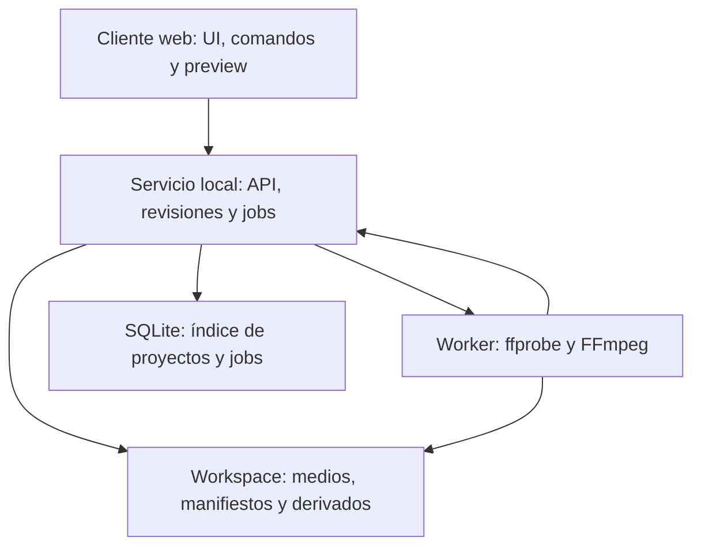
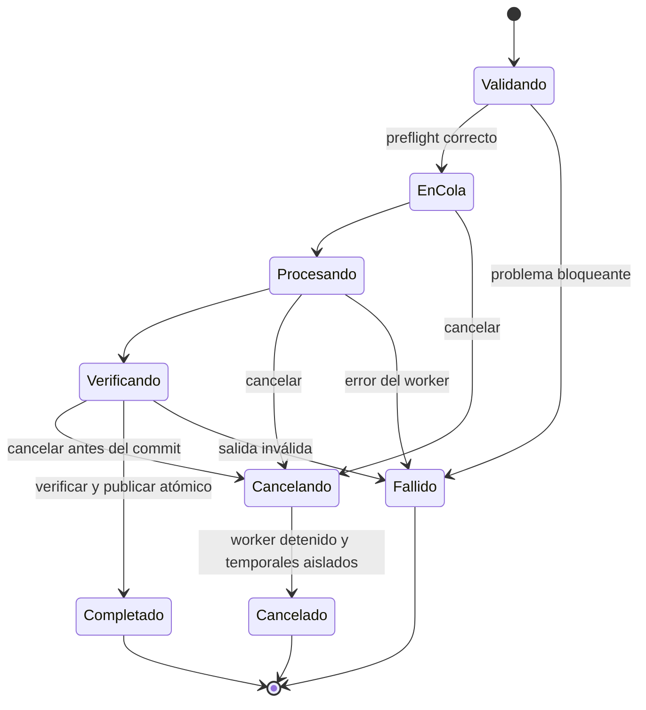
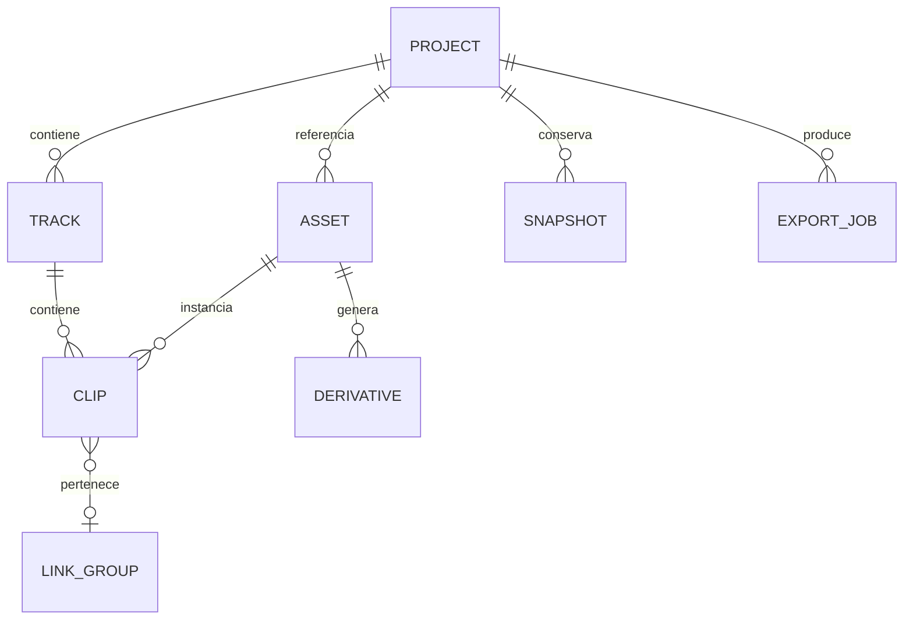

# Diagramas del sistema y de estados

Estos diagramas describen la propuesta de arquitectura y las transiciones del producto; no representan una implementación desplegada. Se incluyen como Mermaid editable y como figuras en el PDF.

## Componentes

## Exportación

Una cancelación posterior a la publicación recibe ALREADY_TERMINAL y muestra el archivo completado. Al reiniciar el servicio, un job que no tenga worker ni salida verificada pasa a interrumpido/fallido recuperable; no se reanuda ni duplica silenciosamente. Reintentar crea otro job con preflight nuevo.

## Modelo de dominio

M1. Los recursos compartidos se preservan mientras haya referencias desde proyectos activos o papelera. Una exportación fija una revisión y no lee cambios posteriores de la sesion.
